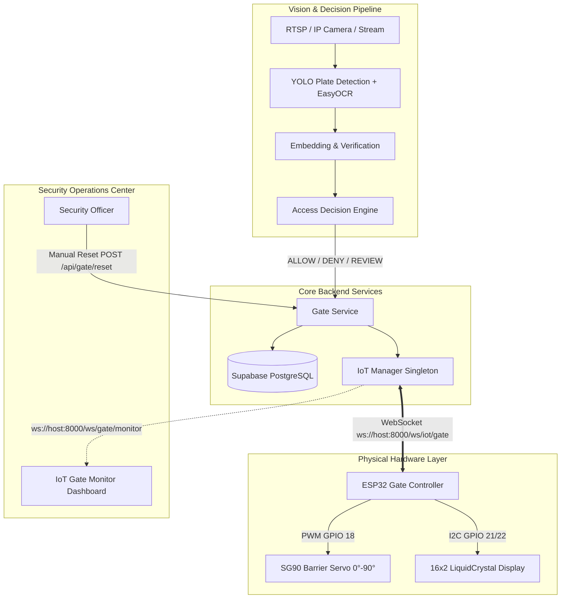
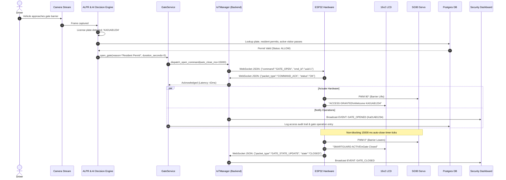

# SmartGuard AI — IoT Gate Controller Architecture & Pipeline Integration

## 1. Executive Overview

The SmartGuard IoT Gate Controller integration bridges the digital AI computer vision & access decision pipeline with physical perimeter hardware. An ESP32 microcontroller actuates an SG90 physical barrier servo and drives a 16×2 I2C LCD display via full-duplex WebSockets over Wi-Fi.



---

## 2. Hardware Architecture & Pinout

### Physical Specifications
| Component | Function | Interface / Pins | Details |
| :--- | :--- | :--- | :--- |
| **ESP32 DevKit V1** | Core Microcontroller | Wi-Fi 802.11 b/g/n (2.4 GHz) | Dual-core Tensilica Xtensa 32-bit LX6 @ 240MHz |
| **TowerPro SG90 Servo** | Gate Barrier Arm | GPIO 18 (PWM Channel 0) | `0°` = Closed (Horizontal), `90°` = Open (Vertical) |
| **16×2 HD44780 LCD** | Driver Instruction Display | I2C: SDA (GPIO 21), SCL (GPIO 22) | Address `0x27` (or `0x3F`), 100 kHz clock |
| **Power Supply** | Common 5V 2A Rails | 5V / VIN & GND | Servo & LCD powered via 5V rail; ESP32 USB powered |

```
                +----------------------------+
                |     ESP32 DEVKIT V1        |
                |                            |
                |  GPIO 18 (PWM) ------------+----> SG90 Servo Signal (Orange)
                |  GPIO 21 (SDA) ------------+----> LCD 16x2 SDA
                |  GPIO 22 (SCL) ------------+----> LCD 16x2 SCL
                |  GND ----------------------+----> Common GND
                |  5V (VIN) -----------------+----> Common 5V Supply Rail
                +----------------------------+
```

---

## 3. Communication Protocol (Full-Duplex WebSockets)

The communication protocol utilizes bidirectional JSON messages over a dedicated persistent WebSocket connection at `/ws/iot/gate`.

### 3.1 Network Endpoint & Handshake
- **Endpoint**: `ws://<BACKEND_HOST>:8000/ws/iot/gate`
- **Authentication**: On connection establishment, the ESP32 must provide:
  - Query parameters: `?device_id=smartguard-esp32-01&device_key=sg_iot_secret_key_...`
  - OR an initial handshake message within 5 seconds.
- **Watchdog / Heartbeat**: The ESP32 emits a heartbeat packet every **10 seconds**. If no heartbeat or frame is received for **30 seconds**, the backend marks the controller as `OFFLINE`.

### 3.2 Packet Specifications

#### A. Backend to ESP32: Open Gate (`GATE_OPEN`)
Sent when an authorized vehicle is detected:
```json
{
  "command": "GATE_OPEN",
  "cmd_id": "c1f8e6c7-3b7c-47bc-bb39-d3e91d8e1234",
  "reason": "Authorized resident entry (KA01AB1234)",
  "auto_close_ms": 15000,
  "display_text": "ACCESS GRANTED",
  "display_subtext": "KA01AB1234 - OPEN"
}
```

#### B. ESP32 to Backend: Command Acknowledgment (`COMMAND_ACK`)
Sent immediately upon receipt and validation of a command:
```json
{
  "packet_type": "COMMAND_ACK",
  "device_id": "smartguard-esp32-01",
  "cmd_id": "c1f8e6c7-3b7c-47bc-bb39-d3e91d8e1234",
  "status": "OK",
  "detail": "Servo actuating to 90 deg"
}
```

#### C. ESP32 to Backend: Gate State Transition (`GATE_STATE_UPDATE`)
Sent whenever the physical barrier completes an open or close transition:
```json
{
  "packet_type": "GATE_STATE_UPDATE",
  "device_id": "smartguard-esp32-01",
  "state": "CLOSED",
  "servo_angle": 0,
  "display_text": "SMARTGUARD ACTIVE",
  "display_subtext": "Gate Closed"
}
```

#### D. ESP32 to Backend: Periodic Heartbeat (`DEVICE_HEARTBEAT`)
Sent every 10 seconds to maintain connection health:
```json
{
  "packet_type": "DEVICE_HEARTBEAT",
  "device_id": "smartguard-esp32-01",
  "device_key": "sg_iot_secret_key_...",
  "firmware_version": "1.0.0",
  "uptime_seconds": 1420,
  "wifi_rssi": -58,
  "free_heap": 182400,
  "gate_state": "CLOSED",
  "servo_angle": 0
}
```

#### E. Backend to ESP32: Status Display Command (`DISPLAY_STATUS`)
Sent during `DENY` or `MANUAL_REVIEW` events without moving the servo:
```json
{
  "command": "DISPLAY_STATUS",
  "cmd_id": "d9812a44-...",
  "line1": "ACCESS DENIED",
  "line2": "Unregistered",
  "duration_ms": 4000
}
```

#### F. Backend to ESP32: Manual Gate Reset (`GATE_CLOSE`)
Sent during security override or reset:
```json
{
  "command": "GATE_CLOSE",
  "cmd_id": "e817bc21-...",
  "reason": "Security officer manual reset"
}
```

---

## 4. End-to-End Pipeline Integration Flow



---

## 5. Decision Branching Logic

| Decision | Barrier Motion | 16×2 LCD Screen | Security Audit & DB Record |
| :--- | :--- | :--- | :--- |
| **`ALLOW`** | **Moves to 90° (Open)** for 15000ms, then auto-closes | `Line 1: GATE OPEN`<br>`Line 2: Closing in: 15s` | Logged as successful entry; gate state set to `OPEN` then `CLOSED` |
| **`DENY`** | **Locked at 0° (Closed)** — no servo actuation | `Line 1: ACCESS DENIED`<br>`Line 2: Unauthorized` | Security alert triggered; security event recorded in PostgreSQL |
| **`MANUAL_REVIEW`** | **Locked at 0° (Closed)** until guard intervention | `Line 1: MANUAL REVIEW`<br>`Line 2: Wait for Guard` | Sent to pending verification queue for guard approval |
| **`EMERGENCY_OVERRIDE`** | **Forced to 90° (Open)** until manual reset | `Line 1: EMERGENCY OPEN`<br>`Line 2: Override Active` | Critical security alert; audible buzzer / system wide banner |
| **`MANUAL_RESET`** | **Forced to 0° (Closed)** with ACK validation | `Line 1: GATE RESET`<br>`Line 2: System Ready` | Guard ID and timestamp recorded in audit log |

---

## 6. Fault Tolerance & Graceful Degradation

1. **Hardware Disconnected / Power Loss**:
   - The backend `IoTManager` detects missed heartbeats after 30 seconds.
   - The state transitions to `OFFLINE`.
   - When access decisions are computed, `GateService` checks `is_hardware_online()`.
   - If offline, the software log still records the event and returns an operational notice: `Physical gate offline — software state maintained`. The backend continues serving without blocking.

2. **Acknowledgment Timeout**:
   - All critical barrier commands (`GATE_OPEN`, `GATE_CLOSE`) use `asyncio.Future` with a 4.0-second timeout.
   - If the ESP32 fails to respond within 4.0 seconds, the future expires, logging a warning event (`GATE_TIMEOUT`) to the event ring buffer and notifying the security dashboard.

3. **Database Concurrency Protection**:
   - Connection pool size is tuned (`pool_size=4, max_overflow=4, pool_recycle=300`) to guarantee that concurrent telemetry polling and WebSocket threads never exceed database pooler connection limits.

4. **Microcontroller Fail-Safe**:
   - The ESP32 Arduino firmware runs a non-blocking `millis()` loop.
   - It does not use blocking `delay()`, ensuring it responds immediately to incoming network packets even while the servo or LCD is active.
   - If the Wi-Fi connection drops, the ESP32 automatically attempts reconnection every 5 seconds while ensuring the physical gate barrier defaults safely to **CLOSED (`0°`)**.

---

## 7. Configuration Reference

### Backend `.env`
```ini
# IoT Hardware Settings
IOT_DEVICE_ID=smartguard-esp32-01
IOT_DEVICE_KEY=sg_iot_secret_key_change_in_production
IOT_HEARTBEAT_TIMEOUT_SECONDS=30.0
IOT_ACK_TIMEOUT_SECONDS=4.0
IOT_AUTO_CLOSE_DURATION_MS=15000
```

### ESP32 Firmware Configuration (`firmware/esp32_gate_controller/esp32_gate_controller.ino`)
```cpp
// Wi-Fi Configuration
const char* WIFI_SSID     = "YOUR_WIFI_SSID";
const char* WIFI_PASSWORD = "YOUR_WIFI_PASSWORD";

// Backend WebSocket Configuration
const char* WS_HOST       = "192.168.1.100";  // Replace with backend IP
const uint16_t WS_PORT    = 8000;
const char* WS_PATH       = "/ws/iot/gate";

// Device Credentials (must match backend .env)
const char* DEVICE_ID     = "smartguard-esp32-01";
const char* DEVICE_KEY    = "sg_iot_secret_key_change_in_production";
```
