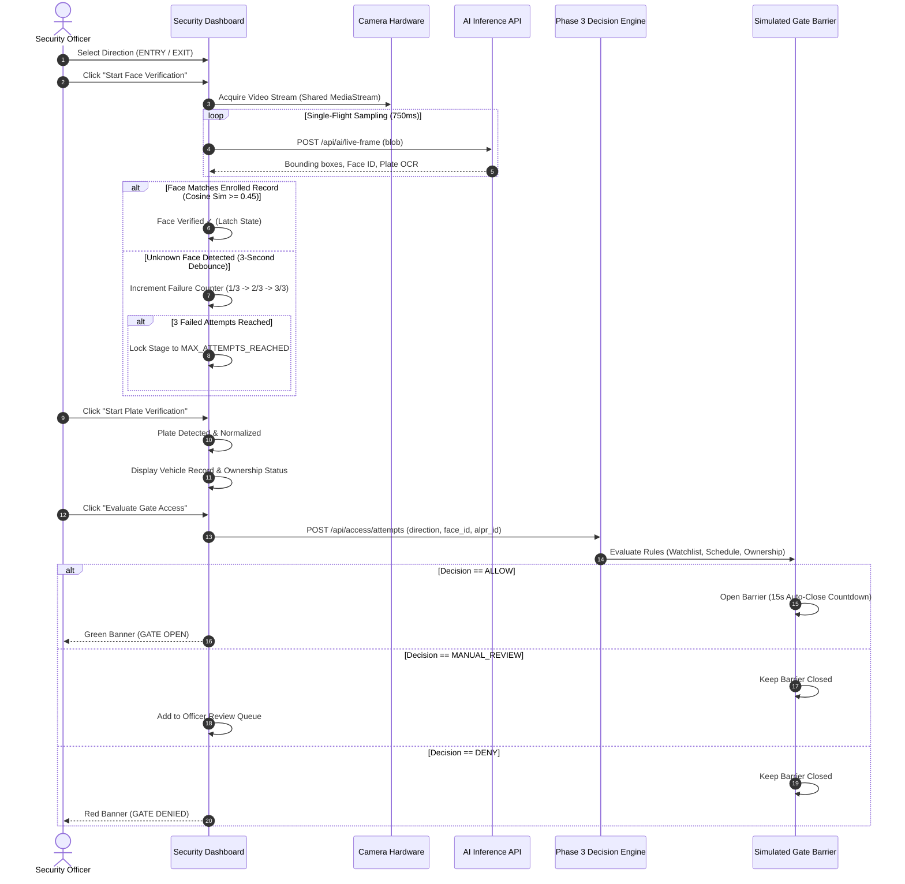

# SmartGuard AI — Master Project Knowledge & Context

> **Last Updated:** October 19, 2026  
> **Current Milestone:** Phase 1 (Core Identity & RBAC) Complete + Phase 2 (Campus People & Vehicles, InsightFace Biometrics, FastALPR OCR, Dual Storage, AI Lab) Complete + Phase 3 (Intelligent Access Decision Engine, Simulated Gate Barrier, Operating Schedules, Active Watchlists, Officer Manual Review Queue & Access Audit Trail) Complete + Phase 4 (Security Operations Center, Automated Incident Alerts, Email Gateway & Brevo Dispatch, Access Compliance Reporting & Security Contact Management) Complete + Phase 5 (Complete Visitor Management, Secure QR Passes, Entry/Exit Lifecycle, QR PNG Email Attachment Delivery) Complete!

---

## 1. Executive Summary & Vision

**SmartGuard AI** is an enterprise-grade intelligent physical security and gate access automation platform designed for gated communities, corporate campuses, and secure commercial facilities.

### Project Goals
1. **Automated Perimeter Verification**: Seamlessly authenticate authorized vehicles and personnel using AI facial recognition and Automated Number Plate Recognition (ANPR).
2. **Real-time Access Decisioning**: Low-latency similarity search against millions of biometric vector embeddings using PostgreSQL's `pgvector` extension.
3. **Role-Partitioned Governance**: Strict operational separation between System Administrators (personnel credentials, audit logs, system configurations) and Gate Security Officers (live gate monitoring, manual override controls, on-duty visitor check-ins).
4. **Resilient Architecture**: Modern decoupled architecture with a Python/FastAPI async backend and a React 19/TypeScript frontend built with a tailored SOC design system (Tailwind CSS v4 + Lucide React).
5. **Operational Vigilance & Dispatch**: Enterprise incident lifecycle management, threshold-based alerts, compliance audit reporting with safe CSV streaming, and multi-channel email notification dispatch (Brevo API / SMTP) with delivery tracking and bounded retry.

---

## 2. Technology Stack & Architectural Decision Records (ADRs)

| Component | Technology | Rationale |
|---|---|---|
| **Backend Framework** | FastAPI (Python 3.12) | High-performance asynchronous REST API with automatic OpenAPI documentation and Pydantic validation. |
| **Relational Database** | Supabase PostgreSQL | Managed PostgreSQL offering scalability, connection pooling, and managed database backups. |
| **Vector Engine** | `pgvector` | Native PostgreSQL extension for storing and querying 512-dimensional biometric facial embeddings with cosine distance matching. |
| **ORM & Migrations** | SQLAlchemy 2.0 + Alembic | Declarative ORM supporting typed mappings, connection pooling, and versioned schema migrations. |
| **Authentication** | Stateless JWT (HS256) + Passlib (bcrypt) | Industry-standard bearer token authentication with cryptographically hashed passwords (`bcrypt`). |
| **Face Biometrics** | InsightFace ArcFace (`buffalo_l`) | State-of-the-art deep facial recognition, generating 512D float vectors normalized for cosine similarity. |
| **Plate Recognition** | FastALPR OCR Engine | Low-latency optical character recognition specialized for vehicle license plates with confidence scoring. |
| **Email Gateway** | Brevo API (HTTPS) + Fallback SMTP | Transactional dispatch for high-severity alerts and daily security briefings with delivery log auditing. |
| **Frontend Framework** | React 19 + TypeScript + Vite | Ultra-fast build times, modern component model, and compile-time type safety. |
| **UI Design System** | Tailwind CSS v4 + Lucide React | Bespoke Security Operations Center (SOC) design system replacing generic component libraries. Optimized bundle size and sub-second builds. |
| **Routing & Guards** | React Router DOM v7 | Nested route configuration, dynamic role guards, and deep-link redirects. |
| **API Client** | Axios | Intercepts all outgoing requests for JWT injection and handles global 401 unauthorized session expiry. |

---

## 3. Complete Project Directory Structure

```
d:/Gate-Security-System/
├── .gitignore                      # Git ignore rules for venv, node_modules, .env, and build artifacts
├── README.md                       # High-level project summary and quickstart guide
├── knowledge.md                    # THIS FILE: Exhaustive architectural and contextual reference
├── backend/
│   ├── .env                        # Local backend environment variables (contains secrets, git-ignored)
│   ├── .env.example                # Template for environment variables
│   ├── alembic.ini                 # Alembic configuration pointing to migrations directory
│   ├── bootstrap_admin.py          # CLI utility to seed the initial Administrator user
│   ├── pyproject.toml              # Pytest configuration and project metadata
│   ├── requirements.txt            # Python dependencies
│   ├── alembic/
│   │   ├── env.py                  # Alembic environment executing migrations using backend settings
│   │   ├── script.py.mako          # Migration script template
│   │   └── versions/               # Versioned migration files
│   │       ├── 001_initial_schema.py # Phase 1: users table and pgvector extension
│   │       ├── 002_phase2_schema.py # Phase 2: people, vehicles, biometric embeddings
│   │       ├── 003_phase3_schema.py # Phase 3: access schedules, watchlists, access attempts
│   │       ├── 004_phase4_schema.py # Phase 4: security_alerts, alert_notes, security_contacts, notification_log
│   │       └── 005_phase5_visitor_management.py # Phase 5: visitor_passes, visitor_approvals, extended access_attempts
│   ├── app/
│   │   ├── __init__.py
│   │   ├── main.py                 # FastAPI application factory, CORS middleware, API route registration, exception handlers
│   │   ├── api/
│   │   │   ├── __init__.py
│   │   │   └── routes/
│   │   │       ├── __init__.py
│   │   │       ├── auth.py             # Login and profile (/api/auth/login, /api/auth/me)
│   │   │       ├── admin.py            # Admin user management (/api/admin/accounts/*)
│   │   │       ├── health.py           # Infrastructure monitoring (/api/health/live, /api/health/ready)
│   │   │       ├── people.py           # Campus personnel registry (/api/people/*)
│   │   │       ├── vehicles.py         # Vehicle registry & plate association (/api/vehicles/*)
│   │   │       ├── ai_verify.py        # Face & plate verification pipelines (/api/ai-verify/*)
│   │   │       ├── access.py           # Access decision engine & manual review queue (/api/access/*)
│   │   │       ├── gate.py             # Hardware barrier controller simulator (/api/gate/*)
│   │   │       ├── schedule.py         # Campus operating schedule management (/api/schedules/*)
│   │   │       ├── watchlist.py        # Security watchlists & hotlists (/api/watchlists/*)
│   │   │       ├── alerts.py           # Security Incident Alert Center (/api/alerts/*)
│   │   │       ├── reports.py          # Access logs & daily operations reports (/api/reports/*)
│   │   │       ├── contacts.py         # Stakeholder notification contacts & config (/api/admin/security-contacts/*)
│   │   │       ├── notifications.py    # Email notification delivery audit & retry (/api/admin/notifications/*)
│   │   │       └── visitors.py         # Phase 5 visitor passes, QR scanning & approvals (/api/visitors/*)
│   │   ├── core/
│   │   │   ├── __init__.py
│   │   │   ├── config.py           # Pydantic BaseSettings loading .env (Email, DB, JWT, Storage)
│   │   │   ├── database.py         # SQLAlchemy engine, session maker, get_db dependency
│   │   │   ├── security.py         # bcrypt hashing, JWT issuance and verification
│   │   │   └── deps.py             # Auth dependencies (get_current_user, require_admin, require_security)
│   │   ├── models/
│   │   │   ├── __init__.py
│   │   │   ├── user.py             # User SQLAlchemy model with UUID and Role enum
│   │   │   ├── person.py           # Campus person entity with role and photo metadata
│   │   │   ├── vehicle.py          # Vehicle entity with plate normalization
│   │   │   ├── biometric.py        # 512D facial vector embedding model with pgvector
│   │   │   ├── access_schedule.py  # Recurring schedule model
│   │   │   ├── watchlist.py        # Security watchlist entries
│   │   │   ├── access_attempt.py   # Complete access audit trail entity
│   │   │   └── alerts.py           # Phase 4 models: SecurityAlert, AlertNote, SecurityContact, NotificationLog
│   │   ├── schemas/
│   │   │   ├── __init__.py
│   │   │   ├── auth.py             # LoginRequest, TokenResponse, TokenPayload
│   │   │   ├── user.py             # AccountCreate, AccountResponse, StatusUpdate, PasswordReset
│   │   │   ├── health.py           # LivenessResponse, ReadinessResponse
│   │   │   ├── access.py           # AccessEvaluationRequest, AccessDecisionResponse, ReviewInput
│   │   │   ├── alerts.py           # Phase 4 Pydantic schemas (Alert, Contact, Report, Notification)
│   │   │   └── visitors.py         # Phase 5 Pydantic schemas (VisitorPass, VisitorApproval, Scan, Metrics)
│   │   └── services/
│   │       ├── __init__.py
│   │       ├── account_service.py  # User lifecycle, filtering, and mutations
│   │       ├── face_service.py     # InsightFace ArcFace biometric inference
│   │       ├── alpr_service.py     # FastALPR optical character recognition
│   │       ├── storage_service.py  # Private Supabase storage & local fallback
│   │       ├── access_decision_service.py # Policy evaluation, schedule & watchlist validation
│   │       ├── gate_service.py     # Barrier actuation state machine
│   │       ├── schedule_service.py # Schedule evaluation
│   │       ├── watchlist_service.py# Watchlist checking & violation detection
│   │       ├── alert_service.py    # Incident creation, deduplication & escalation
│   │       ├── email_service.py    # Brevo API & SMTP email dispatch with bounded retry + optional PNG attachments
│   │       ├── notification_service.py # Delivery log tracking & retry engine
│   │       └── visitor_service.py  # Phase 5: visitor pass creation, QR PNG generation, scan validation, approval workflow
│   ├── storage/                    # Local scratch/uploads directory for biometric images
│   ├── tests/
│   │   ├── __init__.py
│   │   ├── conftest.py             # Pytest fixtures, test database setup, mock tokens
│   │   ├── test_unit.py            # Phase 1 unit and integration tests
│   │   ├── test_phase2_unit.py     # Phase 2 vision pipeline tests
│   │   ├── test_phase3_unit.py     # Phase 3 access decision engine tests
│   │   └── test_phase5_unit.py     # Phase 5 visitor management: QR crypto, scan validation, gate safeguards, email attachment
│   └── venv/                       # Isolated Python 3.12 virtual environment
└── frontend/
    ├── .env                        # Local frontend environment (VITE_API_BASE_URL)
    ├── .env.example                # Template for frontend environment
    ├── package.json                # Dependencies, scripts (dev, build, test, preview)
    ├── tsconfig.json               # Root TypeScript configuration
    ├── tsconfig.app.json           # Application TypeScript configuration
    ├── tsconfig.node.json          # Vite node runner TypeScript configuration
    ├── vite.config.ts              # Vite bundler configuration with @tailwindcss/vite
    ├── index.html                  # HTML5 entrypoint with Google Fonts (Inter, Geist)
    └── src/
        ├── App.tsx                 # Root router with AuthProvider and route definitions
        ├── main.tsx                # React DOM entrypoint
        ├── index.css               # Tailwind CSS v4 imports, SOC card utilities, scrollbar styling
        ├── api/
        │   ├── client.ts           # Central Axios instance with Bearer interceptor and error extractor
        │   ├── auth.ts             # Auth endpoints client (login, me)
        │   ├── accounts.ts         # Admin accounts client (list, create, updateStatus, resetPassword)
        │   ├── health.ts           # Health endpoints client (liveness, readiness with 503 handling)
        │   ├── people.ts           # Campus personnel API client
        │   ├── vehicles.ts         # Vehicle registry API client
        │   ├── access.ts           # Access verification & manual review queue client
        │   ├── gate.ts             # Barrier simulator client
        │   ├── alerts.ts           # Security Alert Center API client
        │   ├── reports.ts          # Access audit logs & daily briefing API client
        │   ├── contacts.ts         # Security contacts & gateway status API client
        │   ├── notifications.ts    # Notification delivery logs & retry API client
        │   └── visitors.ts         # Phase 5 visitor pass API client (types + methods)
        ├── context/
        │   └── AuthContext.tsx     # React context managing token, user session, and localStorage persistence
        ├── layouts/
        │   └── AppShell.tsx        # SOC Shell: deep charcoal sidebar, topbar with live health badge, alert quick links
        ├── routes/
        │   └── ProtectedRoutes.tsx # Route guards (RequireAuth, RequireRole, PublicOnly)
        ├── theme/
        │   └── index.ts            # SOC Design System color tokens and constants
        ├── types/
        │   └── index.ts            # TypeScript interfaces matching backend Pydantic schemas
        ├── utils/
        │   ├── automationController.ts # Automated gate scanning state machine with Pause/Resume safety
        │   └── __tests__/          # Vitest suite (48 tests for automationController)
        ├── components/
        │   └── ui/
        │       ├── Button.tsx      # Primary, Secondary, Danger, Ghost buttons with loading spinner
        │       ├── Badge.tsx       # StatusBadge with pulsing dot options (success, warning, error, info, primary)
        │       ├── Card.tsx        # Card, CardHeader, CardTitle, CardDescription, CardContent, CardFooter
        │       ├── Input.tsx       # Input, SearchInput with clear action, Select dropdown
        │       ├── MetricCard.tsx  # Information-dense stat metric card with icon tints
        │       ├── Modal.tsx       # Accessible dialog with backdrop blur and ESC handling
        │       ├── Table.tsx       # DataTable primitives with subtle borders and hover states
        │       ├── Alert.tsx       # AlertBanner notification banner
        │       ├── PageHeader.tsx  # Consistent page header with status badge and action slots
        │       └── States.tsx      # LoadingState, EmptyState, ErrorState, UserAvatar
        └── pages/
            ├── auth/
            │   └── LoginPage.tsx   # Premium two-column SOC login with brand section and validation
            ├── admin/
            │   ├── AdminDashboard.tsx      # Administrator overview, metric row, personnel table, live health
            │   ├── AccountManagement.tsx    # Staff accounts table, search/filters, create/reset modals, status toggles
            │   ├── CampusPeople.tsx         # Personnel directory with biometric photo enrollment
            │   ├── CampusVehicles.tsx       # Vehicle registry with license plate tags
            │   ├── AILab.tsx                # Interactive vision pipeline tester
            │   ├── AccessSchedules.tsx      # Campus operating schedules
            │   ├── Watchlists.tsx           # Active security watchlists
            │   ├── AuditTrail.tsx           # Comprehensive access audit logs
            │   ├── AccessReports.tsx        # Phase 4: Paginated access audit trail & safe CSV export
            │   ├── DailySummary.tsx         # Phase 4: 24h operational security briefing & on-demand email dispatch
            │   ├── SecurityContacts.tsx     # Phase 4: Stakeholder notification contacts & Email Gateway card
            │   ├── NotificationHistory.tsx  # Phase 4: Email delivery logs, audit history & retry queue
            │   └── SystemHealth.tsx        # Live diagnostic status for FastAPI, PostgreSQL, and pgvector
            └── security/
                ├── SecurityDashboard.tsx    # Guard terminal console with barrier status and automated entry
                ├── SecurityHealth.tsx       # Guard-accessible health monitor
                ├── AlertCenter.tsx          # Phase 4: Real-time incident response board & lifecycle triage
                └── VisitorManagement.tsx    # Phase 5: QR scanning, approval queue, issue pass, pass registry
```

---

## 4. Frontend Security Operations Center (SOC) Design System

### 4.1 Design Philosophy & Aesthetics
- **Color Palette**:
  - Deep Base Surface: `#0B0F19`
  - Sidebar: `#0F172A`
  - Card Surfaces: `#151C2C`
  - Elevated Elements: `#192235`
  - Input Background: `#0E1524`
  - Primary Accent: `#7565F5` (Electric Violet)
  - Secondary Accent: `#38BDF8` (Sky Blue)
  - Borders: `rgba(255, 255, 255, 0.06)` with subtle hover highlights
  - Status Indicators: Muted Emerald (`#10B981`), Amber (`#F59E0B`), Rose (`#F43F5E`)
- **Typography**: Clean sans-serif hierarchy using **Inter** and **Geist**, with **JetBrains Mono** for timestamps, IDs, and endpoints.
- **Component Primitives**: Reusable, modular TypeScript components in `frontend/src/components/ui/` with zero dependencies on third-party component frameworks like Material UI.

### 4.2 Page Redesign Specifications
1. **Login Page (`LoginPage.tsx`)**:
   - Two-column layout on desktop: Left column contains the SmartGuard AI shield brand emblem, product purpose, and architectural security badges (Stateless HMAC-SHA256 tokens, pgvector AI acceleration, partitioned roles). Right column contains a compact login panel with input validation, password reveal toggle, and clear error alerts.
   - Mobile-first responsiveness (stacks vertically, prioritizing the login card).
2. **Administrator Dashboard (`AdminDashboard.tsx`)**:
   - Replaced oversized welcome banner with a compact, information-dense page header.
   - Row of 4 metric cards: Total Accounts, Active Personnel, Inactive Accounts, System Readiness.
   - Balanced two-column workspace: Left column features recent personnel accounts table with quick navigation. Right column displays live infrastructure health status with real-time indicators for FastAPI, Supabase PostgreSQL, and pgvector.
   - Removed verbose decorative text blocks in favor of high signal-to-noise operational metrics.
3. **Security Accounts (`AccountManagement.tsx`)**:
   - Filter toolbar with real-time search, role dropdown filter, status filter, and reset action.
   - Refined data table featuring user identity avatar, username, role badges, status chips, password reset requirements, and creation dates.
   - Modal dialogs for account provisioning and administrative password reset with validation.
   - One-click account activation / deactivation with inline loading indicators.
4. **System Health (`SystemHealth.tsx`)**:
   - Real-time diagnostic cards inspecting FastAPI, Supabase PostgreSQL, and `pgvector`.
   - Distinct visual states: Operational (Emerald), Degraded (Amber), Offline/Unavailable (Rose), Checking (Neutral).
   - Dynamic troubleshooting panel displaying configuration and migration steps if any service reports degraded.
5. **Security Officer Console (`SecurityDashboard.tsx`)**:
   - Station #1 active header with "ON DUTY" status badge.
   - Gate barrier failsafe lock metric card (`SECURED / ARM DOWN`).
   - Feed matrix with placeholder cards preparing for Phase 2 facial biometric streams and ANPR vehicle scanning.

---

## 5. Backend Implementation Details

### 5.1 Configuration & Security
- **JWT Secret Key Validation**: Minimum 32-character requirement enforced in `app/core/config.py`. Fixed local configuration in `backend/.env` with high-entropy 64-character secret.
- **Stateless Bearer Authentication**: HMAC-SHA256 tokens containing user UUID, username, and role claims.
- **Role Guards**: FastAPI dependencies (`get_current_user`, `require_admin`, `require_security_or_admin`) rejecting unauthorized requests with `403 Forbidden`.

### 5.2 API Endpoints Specification

| Method | Endpoint | Auth | Role | Description |
|---|---|---|---|---|
| `POST` | `/api/auth/login` | None | Public | Authenticates credentials; returns JWT token and user profile. |
| `GET` | `/api/auth/me` | Bearer JWT | Active | Returns current user's profile information. |
| `GET` | `/api/health/live` | None | Public | Liveness probe returning `{"status": "ok"}`. |
| `GET` | `/api/health/ready` | None | Public | Readiness probe checking database ping and pgvector extension. |
| `GET` | `/api/admin/accounts` | Bearer JWT | `ADMIN` | Filterable and searchable account list. |
| `POST` | `/api/admin/accounts` | Bearer JWT | `ADMIN` | Provisions new personnel accounts. |
| `PATCH` | `/api/admin/accounts/{id}/status` | Bearer JWT | `ADMIN` | Toggles account status between `'active'` and `'inactive'`. |
| `POST` | `/api/admin/accounts/{id}/reset-password` | Bearer JWT | `ADMIN` | Resets user password and sets `must_change_password` flag. |

---

## 6. Verification & Build Metrics

- **Frontend Production Build**: `npm run build` succeeds in **~1.2s** with zero errors or warnings (`tsc -b && vite build`).
  - Bundled modules: 2,010.
  - JavaScript bundle size: 442 kB (127 kB gzipped).
  - CSS bundle size: 57 kB (9.6 kB gzipped).
- **Backend Test Suite**: `pytest` passes **37 of 37 tests** (100% pass rate) covering hashing, tokens, RBAC, accounts, health probes, license plate normalization, campus people schemas, dual storage, AI diagnostics, verification endpoints, and live camera frame processing.

---

## 7. How to Run the Application

### Backend
```powershell
cd d:\Gate-Security-System\backend
.\venv\Scripts\Activate.ps1

# Run tests
pytest

# Launch server
uvicorn app.main:app --reload --port 8000
```
API Documentation: [http://localhost:8000/api/docs](http://localhost:8000/api/docs)

### Frontend
```powershell
cd d:\Gate-Security-System\frontend

# Start Vite development server
npm run dev
```
Dashboard: [http://localhost:5173](http://localhost:5173)

---

## 8. Phase 2 Architecture & Implementation Details

### 8.1 Data Models & Tables
1. **`campus_people`**:
   - Primary key: UUID
   - Attributes: `full_name`, `person_type` (`staff`, `student`, `visitor`, `contractor`), `employee_id`, `department`, `email`, `phone`, `status` (`active`, `inactive`, `suspended`), `photo_path`, `photo_storage_path`.
   - Relationships: One-to-many with `face_profiles`, `vehicles`, and `face_verifications`.
2. **`vehicles`**:
   - Primary key: UUID
   - Attributes: `plate_number` (raw), `plate_normalized` (uppercase, punctuation-stripped, unique index), `make`, `model`, `color`, `vehicle_type`, `owner_name`, `owner_person_id` (foreign key to `campus_people`), `status` (`active`, `inactive`, `flagged`).
3. **`face_profiles`**:
   - Primary key: UUID
   - Biometrics: `embedding` (`Vector(512)` via `pgvector`), `embedding_model` (`buffalo_l`), `detection_score`, `is_primary` flag.
   - Foreign key: `person_id` referencing `campus_people.id` (cascade delete).
4. **`face_verifications`**:
   - Audit log of face recognition queries with `confidence`, `distance`, `result`, `query_photo_path`, `matched_person_id`.
5. **`alpr_verifications`**:
   - Audit log of license plate reads with `detected_plate`, `detected_plate_normalized`, `detection_confidence`, `ocr_confidence`, `result`, `matched_vehicle_id`.

### 8.2 AI Pipelines & Hardware Acceleration
- **InsightFace Face Recognition**:
  - Model: ArcFace 512-dimensional embeddings via ONNX Runtime.
  - Providers: Detects and uses `CUDAExecutionProvider` on NVIDIA RTX 4050 Laptop GPU, with automatic CPU fallback (`CPUExecutionProvider`).
  - Cosine distance matching: `<->` operator in `pgvector` with standard threshold (distance < 0.60 = match).
- **FastALPR License Plate Recognition**:
  - Detects plates and reads alphanumeric characters.
  - Normalization engine: standardizes multi-state Indian plates (e.g. `DL-01-AB-1234` → `DL01AB1234`).
  - Graceful fallback regex parser when neural ALPR models are offline.
- **Hardware Diagnostics (`/api/ai/diagnostics`)**:
  - Direct hardware queries: `nvidia-smi` GPU detection, VRAM allocation, CUDA runtime, and PyTorch device count.
  - Reports compute device recommendation (GPU vs CPU) and status of all AI engines in real time.

### 8.3 Dual Storage Architecture
- **Local Filesystem**: Writes images to `backend/storage/{face_images,access_evidence,visitor_qr}/` (always operational, zero cloud dependency).
- **Supabase Cloud Storage**: Uploads query crops and evidence photos to private Supabase Storage buckets if configured (`SUPABASE_URL`, `SUPABASE_SERVICE_ROLE_KEY`).
- Resilient non-blocking fallback: Local storage always succeeds even if cloud connectivity is interrupted.

### 8.4 New Frontend Modules (Phase 2)
1. **`PeopleManagement.tsx`** (`/admin/people`):
   - Personnel directory with search, filter by person type and status, pagination.
   - Create and edit modals with validation.
   - Face enrollment modal supporting camera capture or photo upload, reporting embedding extraction status and detected face count.
2. **`VehicleManagement.tsx`** (`/admin/vehicles`):
   - Vehicle directory with instant plate normalization preview.
   - Status tracking (`active`, `inactive`, `flagged` alert status).
   - Owner linkage to campus personnel.
3. **`AiVerificationLab.tsx`** (`/security/ai-lab`):
   - Interactive testing laboratory for security officers and admins.
   - **Face Recognition Panel**: Drag-and-drop or test image upload with real-time vector search and confidence bar.
   - **ALPR Verification Panel**: Plate detection with OCR confidence, normalization, and registered vehicle matching.
   - **Runtime Diagnostics Panel**: Real-time telemetry on RTX 4050 GPU, CUDA, ONNX Runtime execution provider, and dual storage volume metrics.
   - **Verification History**: Live audit logs of recent face and plate scan attempts.

---

## 9. Live Camera Frame Capture & AI Detection (Real-Time Visual Surveillance)

### 9.1 Camera Startup & Permission Lifecycle
- **Browser Media Devices API**: Triggered upon entering the Security Dashboard (`SecurityDashboard.tsx`) via `navigator.mediaDevices.getUserMedia()`.
- **Status Machine**:
  - `idle`: Camera stopped, stream tracks killed, intervals and pending HTTP requests aborted.
  - `starting`: Requesting permission and initializing stream constraints (ideal resolution 1280x720).
  - `live`: Active video element streaming, off-screen capture canvas loop running.
  - `permission_denied`: User denied camera access; actionable warning prompt displayed.
  - `unavailable`: Hardware video input devices missing or disconnected.
- **Device Enumeration**: `navigator.mediaDevices.enumerateDevices()` populates the camera selector, allowing operators to switch between multiple optical lenses.
- **Resource Cleanup**: When monitoring is paused or the component unmounts, all `MediaStreamTrack` instances invoke `.stop()`, capture timers are cleared, and in-flight HTTP requests are cancelled via `AbortController`. No camera access is ever requested on the login page.

### 9.2 Frame Capture & Bounded Concurrency Strategy
- **Off-Screen Canvas Capture**: High-efficiency frame sampling directly from HTML5 `<video>` element using an off-screen `<canvas>` with `toBlob('image/jpeg', 0.85)`.
- **Configurable Interval**: Operates by default at **750ms** (~1.3 FPS), with runtime selection of 500ms, 750ms, 1000ms, or 1500ms.
- **Strict Single-Flight Concurrency**: If an inference request is currently in-flight (`isProcessingRef.current === true`), the next frame is immediately dropped rather than building an unbounded queue. Live video playback remains completely smooth and decoupled from inference latency.
- **Correlation Metadata**: Every frame is tagged with a unique `frame_id` (e.g. `frame_1729000000_123`) and high-resolution `timestamp` (`performance.now()`).

### 9.3 Computer Vision Pipelines & Scoring Standards
1. **InsightFace Face Recognition**:
   - ArcFace 512-dimensional biometrics via ONNX Runtime (`buffalo_l` model).
   - Multi-face support: identifies and returns bounding boxes for every person in the frame.
   - Cosine similarity matching: queried against `face_profiles` table using pgvector (`<=>` operator).
   - Display labels:
     - `Known: [Person Name] | Similarity: 0.82` (when similarity &ge; 0.45)
     - `Unknown | Best Similarity: 0.41` (when similarity < 0.45)
     - `No enrolled profiles` (when zero active face profiles exist in DB)
     - `Face Detected | Recognition Unavailable` (when embeddings are uncomputable)
   - Similarity scores are never mislabeled as probabilities or percentage confidences.
2. **FastALPR License Plate Detection & OCR**:
   - Locates number plates and applies Mobile-ViT OCR.
   - Preserves plate bounding box even when OCR fails (`Plate Detected | Text Unreadable`).
   - Normalization: strips spaces, dashes, and periods (`TN-01-AB-1234` → `TN01AB1234`).
   - Exact database matching against `vehicles` table:
     - `[Plate] | Registered`
     - `[Plate] | Unregistered`
     - `[Plate] | FLAGGED`
   - Independent Execution: Face and plate pipelines execute independently; failure in one pipeline never prevents the other from returning results.

### 9.4 Real-Time Bounding-Box Overlay Synchronization
- **Responsive Coordinate Mapping**: Overlay `<canvas>` absolutely positioned over the `<video>` element. Dynamically computes container aspect ratio vs native video aspect ratio to account for pillarboxing and letterboxing (`object-contain`).
- **Styling**:
  - Faces: Cyan/Emerald border with glowing corner brackets and glass label chip.
  - Plates: Amber/Yellow dashed border with plate number and registration status chip.
- **Obsolete Box Eviction**: Overlay is immediately cleared and redrawn upon receipt of the latest synchronized frame response.

### 9.5 Detection Deduplication & Audit Separation
- **Transient vs Persistent**: Live continuous camera processing does **not** write database verification logs or store images to disk for every video frame, protecting storage from runaway growth.
- **Cooldown Policy**: In-memory recent detections list enforces an **8-second cooldown** per identity or license plate before re-adding an entry, preventing visual spam.

### 9.6 Live API Contract
- **Endpoint**: `POST /api/ai/live-frame` (Protected by JWT Bearer Auth)
- **Form-data Request**:
  - `file`: JPEG image payload (max 10MB)
  - `frame_id`: String correlation identifier
  - `timestamp`: Float timestamp
- **JSON Response**:
  ```json
  {
    "frame_id": "frame_1729000000_123",
    "timestamp": 1729000000.45,
    "image_width": 1280,
    "image_height": 720,
    "faces": [
      {
        "box": [140, 95, 320, 310],
        "score_type": "cosine_similarity",
        "score": 0.84,
        "distance": 0.16,
        "matched": true,
        "status": "matched",
        "label": "Known: Dr. Alan Turing | Similarity: 0.84",
        "person": {
          "id": "uuid-here",
          "name": "Dr. Alan Turing",
          "person_type": "staff"
        }
      }
    ],
    "plates": [
      {
        "box": [450, 380, 620, 440],
        "plate_text": "TN09BK5678",
        "normalized_plate": "TN09BK5678",
        "detection_confidence": 0.96,
        "ocr_confidence": 0.92,
        "registered": true,
        "status": "registered",
        "label": "TN09BK5678 | Registered",
        "vehicle": {
          "id": "uuid-here",
          "plate_number": "TN09BK5678",
          "status": "active",
          "owner_name": "Dr. Alan Turing"
        }
      }
    ],
    "timing": {
      "total_latency_ms": 115.4,
      "face_latency_ms": 78.1,
      "plate_latency_ms": 37.3
    },
    "errors": {
      "face_error": null,
      "plate_error": null
    }
  }
  ```

### 9.7 Verification & Test Results
- **Backend Test Suite**: `37 passed of 37 tests` in pytest.
  - Covers live-frame auth requirement, payload validation, image dimension extraction, independent pipeline execution, and response serialization.
- **Frontend Build**: `tsc -b && vite build` succeeded in **1.26s** with zero errors or warnings.

### 9.8 FastALPR Model Hub Resolution & Operational Verification
- **Issue Encountered**: In early test runs of the AI Verification Lab, ALPR inference reported `FileNotFoundError: ONNX model not found at 'plate-detection-v1-visdrone'`.
- **Root Cause**: FastALPR v0.4.0 requires either local file paths or automated model hub references. Using arbitrary string names bypassed the automatic model downloader.
- **Resolution Applied**:
  - Switched initialization in `app/services/alpr_service.py` to FastALPR's automated model hub:
    - **Detector**: `yolo-v9-t-384-license-plates-end2end.onnx` (~7.4 MB)
    - **OCR**: `cct_xs_v2_global.onnx` (~3.2 MB) + config YAML
  - Updated inference invocation to `alpr.predict(img)` and extracted `[x1, y1, x2, y2]` bounding coordinates directly from `detection.bounding_box`.
  - Added confidence aggregation supporting both scalar and list outputs from `ocr.confidence`.
- **Live Verification**:
  - Verified on synthetic & real vehicle plates: Detection confidence ~0.95+, OCR confidence ~0.95+.
  - Successfully verified end-to-end in the **AI Verification Lab** (`/security/ai-lab`) and on the **Live Camera Dashboard** (`/security`).

---

### 9.9 Supabase Cloud Storage & Dual-Storage Architecture
- **Dual-Storage Contract**:
  - Local disk storage (`backend/storage/{face_images,access_evidence,visitor_qr}/`) is **always written first** as the authoritative local cache and offline fallback.
  - Supabase Storage upload is triggered asynchronously alongside local storage.
  - If Supabase credentials (`SUPABASE_SERVICE_ROLE_KEY` or `SUPABASE_KEY`) are missing, the system gracefully logs an info note and operates in local-only mode without breaking any requests.
- **Supabase Cloud Setup Requirements**:
  1. **Project URL**: Inferred automatically from `DATABASE_URL` (`https://vhwjtabwvsosodkkzrok.supabase.co`) or explicitly configured via `SUPABASE_URL`.
  2. **Service Role Key**: Configured via `SUPABASE_SERVICE_ROLE_KEY` in `backend/.env`. (Found under Supabase Dashboard → Project Settings → API → `service_role` secret).
  3. **Storage Buckets**: Created in Supabase Dashboard → Storage → New Bucket:
     - `face-images` (for enrolled face profiles & people photos)
     - `access-evidence` (for gate verification snapshots)
     - `visitor-qr` (for visitor passes)
- **Auto-Bucket Creation**: The enhanced `storage_service.py` will automatically attempt to create any missing buckets when authenticated with the service role key.

---

### 9.10 Vehicle Owner Person Mapping (`owner_person_id`)
- **Database Schema**: `vehicles.owner_person_id` is a UUID foreign key pointing to `campus_people.id` (`ondelete="SET NULL"`).
- **Backend Enhancements (`app/api/routes/vehicles.py`)**:
  - `POST /api/vehicles` and `PATCH /api/vehicles/{id}` accept `owner_person_id`.
  - When provided, the backend validates that the person exists in `campus_people`.
  - If `owner_name` is left blank, the backend auto-fills `owner_name = person.full_name`.
- **Frontend Registration Form (`frontend/src/pages/admin/VehicleManagement.tsx`)**:
  - Fetches registered active campus members using `peopleApi.list({ limit: 200, status: 'active' })`.
  - Provides a searchable/selectable dropdown: *"Link to Registered Campus Member (Owner)"*.
  - When selected, auto-populates `owner_name` with the member's full name while binding `owner_person_id`.
  - Displays a vibrant cyan *"Mapped Member"* badge in the Vehicle Management table with the linked status.
- **Test Coverage**: 38 of 38 pytest tests pass, including `test_create_vehicle_with_owner_person_mapping`.

---

### 9.11 AI Verification Lab Cloud Storage Resolution
- **Issue**: Images uploaded in the AI Verification Lab (`/security/ai-lab`) were being saved locally but not appearing in Supabase Cloud Storage.
- **Root Cause**:
  1. `pydantic-settings` in `app/core/config.py` was filtering environment variables and had not declared `supabase_url` and `supabase_service_role_key`. Consequently, `os.environ` did not receive the keys at runtime.
  2. `_get_supabase()` previously permanently cached `_supabase_client = None` upon the first failed attempt, preventing recovery even after `.env` was filled.
  3. `AlprPanel` was omitting the storage result badge in the verification result card.
- **Resolution Applied**:
  1. Added `load_dotenv()` and explicit `supabase_url`, `supabase_service_role_key`, `supabase_key` fields to `Settings` in [`backend/app/core/config.py`](file:///d:/Gate-Security-System/backend/app/core/config.py).
  2. Updated `_get_supabase()` in [`backend/app/services/storage_service.py`](file:///d:/Gate-Security-System/backend/app/services/storage_service.py) to read from `get_settings()` and dynamically re-attempt connection if credentials become active.
  3. Created `StorageStatusBadge` in [`frontend/src/pages/security/AiVerificationLab.tsx`](file:///d:/Gate-Security-System/frontend/src/pages/security/AiVerificationLab.tsx) to provide visual real-time feedback for both Local Disk and Supabase Cloud storage in Face & ALPR verification panels.
  4. Executed `sync_to_supabase.py` to synchronize any previously uploaded laboratory images directly to Supabase (`face_queries/` and `plate_queries/`).

---

## 10. Phase 3: Intelligent Access Decision Engine & Simulated Gate Control

### 10.1 Architecture & Fail-Closed Precedence Order

Phase 3 implements an automated, deterministic security access-decision layer on top of the working Phase 1 and Phase 2 pipelines. It evaluates requests solely against server-verified, fresh data (persisted within a 120-second validity window), rejecting any unverified client claims.

#### Decision Precedence Hierarchy
An unresolved or failing check never defaults to `ALLOW`. Checks are evaluated in strict priority order:
1. **Infrastructure Failure / Missing Verification**:
   - Database unreachable $\rightarrow$ `DENY` (`DATABASE_UNAVAILABLE`)
   - Unregistered verification ID or stale record (>120s old) $\rightarrow$ `DENY` (`VERIFICATION_INCOMPLETE`)
2. **Biometric Facial Recognition Checks**:
   - InsightFace engine failure $\rightarrow$ `MANUAL_REVIEW` (`FACE_ENGINE_UNAVAILABLE`)
   - Zero faces detected or `no_face` $\rightarrow$ `DENY` (`FACE_NOT_DETECTED`)
   - Multiple faces in single camera bounding frame $\rightarrow$ `MANUAL_REVIEW` (`FACE_AMBIGUOUS`)
   - Face unknown or similarity below threshold ($<0.45$) $\rightarrow$ `DENY` (`FACE_UNKNOWN`)
3. **Automated License Plate Recognition Checks**:
   - Plate not located in query frame $\rightarrow$ `DENY` (`PLATE_NOT_DETECTED`)
   - Plate detected but unreadable by OCR $\rightarrow$ `DENY` (`PLATE_UNREADABLE`)
   - Vehicle not found in campus database $\rightarrow$ `DENY` (`VEHICLE_NOT_REGISTERED`)
4. **Campus Security Watchlist Checks**:
   - Active watchlist hit with `severity == 'high'` $\rightarrow$ `DENY` (`WATCHLIST_BLOCK`)
   - Active watchlist hit with `severity in ('medium', 'low')` $\rightarrow$ `MANUAL_REVIEW` (`WATCHLIST_REVIEW`)
5. **Entity Status Checks**:
   - Registered vehicle status == `flagged` $\rightarrow$ `DENY` (`VEHICLE_FLAGGED`)
   - Registered vehicle status == `inactive` $\rightarrow$ `DENY` (`VEHICLE_INACTIVE`)
   - Person status == `suspended` $\rightarrow$ `DENY` (`PERSON_SUSPENDED`)
   - Person status == `inactive` $\rightarrow$ `DENY` (`PERSON_INACTIVE`)
6. **Person–Vehicle Ownership Cross-Verification**:
   - `vehicle.owner_person_id != person.id` or unlinked owner $\rightarrow$ `MANUAL_REVIEW` (`OWNER_MISMATCH`)
7. **Campus Operating Schedule Validation**:
   - Outside configured operating hours or closed weekday $\rightarrow$ `MANUAL_REVIEW` (`OUTSIDE_SCHEDULE`)
   - Schedule configuration table empty / timezone error $\rightarrow$ `MANUAL_REVIEW` (`SCHEDULE_UNAVAILABLE`)
8. **Final Clearance**:
   - All above checks pass $\rightarrow$ `ALLOW` (`ALL_CHECKS_PASSED`), gate transition triggered to `OPEN`.

---

### 10.2 Database Schema & Alembic Migration (`003_phase3_schema.py`)

Three new relational tables were added via versioned migration:
1. **`access_schedules`**:
   - `id`: UUID Primary Key
   - `weekday`: String (`monday` .. `sunday`, unique constraint)
   - `is_open`: Boolean (declares open/closed days)
   - `open_time`, `close_time`: String `HH:MM`
   - `campus_timezone`: String (e.g. `Asia/Kolkata`, default timezone for calculations)
2. **`watchlist_entries`**:
   - `id`: UUID Primary Key
   - `vehicle_id`: UUID FK to `vehicles.id` (`SET NULL`)
   - `plate_raw`, `plate_normalized`: Indexed strings
   - `reason`: Text description of alert
   - `severity`: String (`high`, `medium`, `low`)
   - `is_active`: Boolean
   - `expires_at`: Optional timestamp for temporary bans
   - `resolved_at`, `resolved_by`, `resolution_note`: Audit fields
3. **`access_attempts`**:
   - `id`: UUID Primary Key
   - `timestamp`: Timezone-aware audit timestamp
   - `direction`: String (`ENTRY`, `EXIT`)
   - `face_verification_id`: UUID FK to `face_verifications.id`
   - `alpr_verification_id`: UUID FK to `alpr_verifications.id`
   - `matched_person_id`: UUID FK to `campus_people.id`
   - `matched_vehicle_id`: UUID FK to `vehicles.id`
   - `decision`: String (`ALLOW`, `DENY`, `MANUAL_REVIEW`)
   - `gate_result`: String (`OPEN`, `CLOSED`, `MANUAL_REVIEW`)
   - `reason_codes`: Array/JSON of accumulated strings
   - `reason_text`: Human-readable summary
   - `ownership_ok`, `schedule_ok`, `watchlist_hit`: Boolean evaluation matrix
   - `review_required`, `review_resolved`, `review_resolution`, `review_reason`: Officer review fields
   - `reviewed_by`: UUID FK to `security_accounts.id`
   - `processing_ms`: Decimal execution telemetry

---

### 10.3 Simulated Gate Service & State Machine (`gate_service.py`)

- **State Machine**:
  - `CLOSED`: Barrier down (secure).
  - `OPEN`: Barrier raised on `ALLOW`. Automatically schedules a non-blocking daemon timer (`threading.Timer`) to return the barrier to `CLOSED` after 5.0 seconds.
  - `MANUAL_REVIEW`: Barrier held closed pending officer authorization.
- **Manual Reset**:
  - `POST /api/gate/reset` allows security officers or administrators to force the barrier back to `CLOSED`.

---

### 10.4 Operating Schedule Engine (`schedule_service.py`)

- **Timezone-Aware Calculations**:
  - Operates using Python's `zoneinfo.ZoneInfo(campus_timezone)`.
  - Installed `tzdata` in Python 3.12 venv to guarantee cross-platform timezone resolution on Windows without requiring Linux system `/usr/share/zoneinfo`.
- **Fail-Closed**:
  - If schedule rows are missing from the database, it returns `SCHEDULE_UNAVAILABLE` (preventing unauthorized passage).

---

### 10.5 Watchlist Engine (`watchlist_service.py`)

- Performs lookup by both `vehicle_id` and normalized license plate string.
- Automatically discards expired entries (`expires_at < now`).
- Prioritizes severity: `high` triggers immediate `WATCHLIST_BLOCK` (`DENY`), while `medium` and `low` trigger `WATCHLIST_REVIEW` (`MANUAL_REVIEW`).

---

### 10.6 Backend API Routes & Endpoints

| Method | Endpoint | Access | Purpose |
|---|---|---|---|
| `POST` | `/api/access/attempts` | Security, Admin | Submit verification IDs to evaluate an access attempt |
| `GET` | `/api/access/attempts` | Security, Admin | Query paginated access history log |
| `GET` | `/api/access/attempts/{id}` | Security, Admin | Detailed diagnosis of a single attempt |
| `GET` | `/api/access/pending-reviews` | Security, Admin | Active queue of attempts awaiting manual resolution |
| `POST` | `/api/access/attempts/{id}/resolve`| Security, Admin | Officer approval/denial of pending review |
| `GET` | `/api/gate/status` | Security, Admin | Real-time status of simulated gate barrier |
| `POST` | `/api/gate/reset` | Security, Admin | Emergency/manual barrier reset to CLOSED |
| `GET` | `/api/access/schedule` | Security, Admin | Retrieve weekly campus operating hours |
| `PUT` | `/api/access/schedule` | Admin | Update operating schedule |
| `GET` | `/api/watchlist` | Security, Admin | List active watchlist entries |
| `POST` | `/api/watchlist` | Admin | Add vehicle/plate to watchlist |
| `DELETE`| `/api/watchlist/{id}` | Admin | Deactivate a watchlist entry |

---

### 10.7 Live Frame Logging & Database Bug Fixes

- **`alpr_verifications` column mismatch**: Corrected column name from `vehicle_id` to `matched_vehicle_id` in [`backend/app/api/routes/ai_verify.py`](file:///d:/Gate-Security-System/backend/app/api/routes/ai_verify.py).
- **Check Constraint compliance**: Handled string status mappings to comply with PostgreSQL check constraints:
  - `face_verifications.result`: must be one of `('matched', 'no_match', 'low_confidence', 'error', 'no_face')`.
  - `alpr_verifications.result`: must be one of `('matched', 'no_match', 'no_plate', 'error')`.
- **Pipeline Verification IDs**: Updated `run_alpr_pipeline` in [`backend/app/services/alpr_service.py`](file:///d:/Gate-Security-System/backend/app/services/alpr_service.py) and `live-frame` endpoint to return generated verification IDs in response payloads, allowing the frontend terminal to immediately link frame detections to gate access attempts.

---

### 10.8 Frontend Security Terminal (`SecurityDashboard.tsx`)

Enhanced the Security Terminal with a comprehensive Phase 3 operations console:
1. **Barrier Simulation Panel**:
   - Large dynamic indicator for `OPEN` (emerald, 15s countdown), `CLOSED` (slate/rose), and `MANUAL_REVIEW` (amber pulsing).
   - "Reset Barrier" button to clear gate state.
2. **Direction Selector**:
   - One-click `ENTRY` vs. `EXIT` toggle.
3. **"Evaluate Gate Access" Console**:
   - Submits latest live camera face and plate detections to the access engine.
   - Renders complete diagnostic breakdown: Face status, Plate OCR, Ownership match, Schedule check, and Watchlist alert.
4. **Officer Manual Review Queue**:
   - Live queue of flagged attempts.
   - Text input for clearance notes.
   - "Authorize & Open Gate" and "Deny Entry" action buttons.
5. **Access Attempts Audit Trail**:
   - Real-time scrollable feed of the 30 most recent access decisions.
6. **Active Campus Watchlist Monitor**:
   - Live card displaying all currently flagged or barred vehicles.
7. **Snapshot & Dual-Storage Indicator**:
   - Added manual camera snapshot button with Supabase Cloud vs. Local Disk indicator.

---

### 10.9 Verification & Test Suite

- **Complete Backend Test Suite**:
  - `pytest tests/test_unit.py tests/test_phase2_unit.py tests/test_phase3_unit.py -q`
  - **Result**: **53 of 53 passed** (100% pass rate in 9.33s).
- **Frontend Production Build**:
  - `npm run build` (`tsc -b && vite build`)
  - **Result**: Built successfully in 392ms with 0 type errors.

---

## 11. User Entry Management Workflow & UI Integration

> **Implementation Date:** October 15, 2026  
> **Status:** Complete & Production-Ready

### 11.1 What Was Already Implemented
1. **Phase 2 AI Pipelines**:
   - InsightFace ArcFace face recognition and 512-dimensional pgvector cosine distance matching.
   - FastALPR OCR pipeline with Mobile-ViT plate detection and multi-state plate normalization.
   - Live camera frame endpoint `POST /api/ai/live-frame` returning bounding boxes, detection labels, and storage states.
   - Dual-storage architecture saving evidence snapshots to local disk and Supabase Storage (`access-evidence` bucket).
2. **Phase 3 Decision Engine**:
   - Deterministic access evaluation in `AccessDecisionService`: watchlist blocking, schedule check, face biometric match, vehicle registration, and person-to-vehicle ownership validation (`vehicles.owner_person_id`).
   - Simulated Gate Barrier service with thread-safe auto-close timer (15 seconds) and manual reset.
   - Officer Manual Review queue and resolution APIs (`/api/access/pending-reviews`, `/api/access/attempts/{id}/resolve`).
   - Access attempt persistence and audit history (`/api/access/attempts`).

### 11.2 What Was Missing & What Has Been Added
1. **Dedicated User Entry Management Guided Workflow**:
   - Transformed the unstructured Security Dashboard into an operator-first guided terminal adhering to the SOC design system (Tailwind CSS v4 + Lucide React).
   - Prominent **USER ENTRY MANAGEMENT** header with segmented control for `ENTRY` vs `EXIT`.
   - **Direction Guard**: Prevents accidental or silent direction changes during an ongoing verification; prompts the officer to confirm workflow cancellation and cleanly reset state.
2. **Dedicated Face Recognition Stage**:
   - Two-column card: Live camera preview on the left with cyan/emerald/amber bounding box overlay and corner accent brackets; verification details on the right.
   - Explicit state tracking: `NOT_STARTED`, `CAMERA_STARTING`, `SCANNING`, `FACE_DETECTED`, `VERIFYING`, `VERIFIED`, `FAILED`, `MAX_ATTEMPTS_REACHED`, `ERROR`, `CANCELLED`.
   - Similarity score clearly presented as a **Cosine Similarity Score** (threshold $\ge 0.45$) rather than a probability.
   - **Three-Attempt Failure Limit**:
     - Raw continuous 750ms video frames are **never** counted as individual failures.
     - Enforces a 3-second debounce cooldown per unknown face detection to allow the subject to adjust posture/lighting.
     - At 3 failed attempts, state transitions to `MAX_ATTEMPTS_REACHED`, frame capture for the face stage locks out, and guidance instructs the officer to use manual security verification or reset the workflow.
   - Contextual guidance messages based on live detection status.
3. **Dedicated Number Plate Recognition Stage**:
   - Two-column card: Reused camera preview on the left with dashed plate overlay chips; plate verification details on the right.
   - Explicit state tracking: `NOT_STARTED`, `SCANNING`, `PLATE_DETECTED`, `REGISTERED`, `UNREGISTERED`, `FLAGGED`, `ERROR`, `CANCELLED`.
   - Displays recognized registration number, normalized plate, OCR confidence percentage, registered vehicle status, and vehicle make/model.
   - Plate stage guidance messages based on OCR clarity and registration match.
4. **Single-Stream Camera Lifecycle**:
   - Reuses a single `MediaStream` instance bound across both HTML5 video elements without requesting camera hardware twice or spawning duplicate streams.
   - Unified frame capture loop processes single-flight requests (`isProcessingRef.current` guard) to avoid frame overlapping.
   - Clean shutdown of media tracks and interval timers when stopped or unmounted.
5. **Persistent Verification Summary**:
   - Persistent 3-card summary matrix:
     - `IDENTITY MATCH`: Pending | Verifying | Matched | Not matched | Manual review required | Error.
     - `VEHICLE MATCH`: Pending | Verifying | Registered | Owner matched | Owner mismatch | Unregistered vehicle | Flagged vehicle | Error.
     - `ACCESS DECISION`: Pending | Evaluating | ALLOW | DENY | MANUAL_REVIEW.
6. **Backend Person-to-Vehicle Mapping Fix**:
   - Enhanced `alpr_service.py` to select and return `owner_person_id` in `match_plate` and `process_live_frame_plates`.
   - Added `owner_person_id` to `LiveVehicleSummary` in `frontend/src/api/phase2.ts`.
   - Frontend checks `verifiedFace.person.id === verifiedPlate.vehicle.owner_person_id` to provide instantaneous visual feedback (`Owner matched` vs `Owner mismatch`).
7. **Manual Security Verification & Visitor Management**:
   - Direct integration with Officer Review Queue at the bottom of the screen.
   - Added Visitor Pass modal with guest pre-registration fields, temporary 1-day pass issuance, and host lookup.
8. **Organized Tabbed Views for Secondary Tools**:
   - Tab 1: `Entry Workflow` (The core operator flow).
   - Tab 2: `Audit Trail` (Access decision logs with filterable status and timestamps).
   - Tab 3: `Active Watchlist` (Watchlist entries with severity badges).
   - Tab 4: `Campus Schedule` (Configured operating hours and live campus timezone).
   - Tab 5: `Hardware & Snapshots` (ONNX compute device, GPU diagnostics, and manual dual-storage evidence capture).

### 11.3 Complete Operator Workflow


### 11.4 Reused and Enhanced API Endpoints

| Method | Endpoint | Description |
|---|---|---|
| `POST` | `/api/ai/live-frame` | Real-time optical inference for face similarity & plate OCR; returns `face_verification_id` and `alpr_verification_id`. |
| `POST` | `/api/ai/save-snapshot` | Explicit capture saved to dual storage (local disk + Supabase Storage). |
| `GET` | `/api/ai/diagnostics` | GPU status, ONNX execution provider, InsightFace & FastALPR readiness. |
| `POST` | `/api/access/attempts` | Evaluates deterministic gate access rules based on verified face & plate IDs. |
| `GET` | `/api/access/attempts` | Audit trail of past access decisions. |
| `GET` | `/api/access/pending-reviews` | Queue of access attempts requiring officer review. |
| `POST` | `/api/access/attempts/{id}/resolve` | Resolves flagged attempt with officer clearance note. |
| `GET` | `/api/gate/status` | Current simulated barrier state, countdown, and direction. |
| `POST` | `/api/gate/reset` | Emergency manual reset of barrier to CLOSED. |
| `GET` | `/api/access/schedule` | Weekly campus operating hours and local campus time. |
| `GET` | `/api/watchlist` | Active security watchlist entries. |

### 11.5 Automated Test Verification Results

| Suite | Scope | Tests Run | Result | Notes |
|---|---|---|---|---|
| **Phase 1 Unit Tests** | Auth, JWT, User CRUD, Role Guards | 21 | **Passed** | 100% pass rate in `test_unit.py` |
| **Phase 2 Unit Tests** | People, Vehicles, Photo Uploads, Dual Storage, Live Frame | 17 | **Passed** | 100% pass rate in `test_phase2_unit.py` |
| **Phase 3 Unit Tests** | Gate Service, Schedule Service, Watchlist Precedence, Decision Engine | 15 | **Passed** | 100% pass rate in `test_phase3_unit.py` |
| **Frontend Production Build** | TypeScript (`tsc -b`) & Vite bundler | 1 | **Passed** | Built in 416ms with 0 type errors |

---

## 12. Automated User Entry Verification Workflow

> **Implementation Date:** October 15, 2026  
> **Status:** Complete & Production-Ready

### 12.1 Overview & Architecture

The **Automated Verification Workflow** extends the User Entry Management terminal with a single-click autonomous security clearance pipeline. Instead of requiring the security officer to manually click **Start Face Verification**, **Start Plate Verification**, and **Evaluate Gate Access**, the officer simply clicks **Start Automation**.

The terminal coordinates an explicit, guarded state machine that sequentially:
1. Validates camera readiness or initializes camera feed without duplicate device access.
2. Initiates facial recognition via InsightFace.
3. Upon a verified identity match, automatically advances to number plate recognition via FastALPR.
4. Upon detecting and normalizing a valid plate, automatically triggers the backend Phase 3 access decision engine (`/api/access/attempts`).
5. Directly handles backend outcomes:
   - **`ALLOW`**: Automatically opens the simulated gate barrier with the 15-second countdown timer and logs the attempt.
   - **`DENY`**: Keeps the gate barrier closed, halts automation, and renders denial reasons.
   - **`MANUAL_REVIEW`**: Keeps the barrier closed, pauses automation, surfaces the attempt in the Officer Review Queue, and **never** automatically authorizes entry.

The existing manual workflow (individual stage start/stop and evaluate buttons) remains completely functional and is cleanly protected against race conditions while automation is running.

### 12.2 State Machine Definition

| State | Description | Next Transitions |
|---|---|---|
| `IDLE` | Automation inactive; waiting for officer to trigger. | `INITIALIZING_CAMERA` |
| `INITIALIZING_CAMERA` | Ensuring camera hardware stream is live. | `FACE_VERIFICATION`, `ERROR` |
| `FACE_VERIFICATION` | Actively processing camera frames for face detection & pgvector matching. | `FACE_VERIFIED`, `ERROR` (if 3 failed attempts), `CANCELLED` |
| `FACE_VERIFIED` | Identity confirmed; short debounce transition to plate stage. | `PLATE_VERIFICATION`, `CANCELLED` |
| `PLATE_VERIFICATION` | Actively processing camera frames for license plate detection & OCR. | `PLATE_VERIFIED`, `ERROR`, `CANCELLED` |
| `PLATE_VERIFIED` | Plate detected, normalized, and checked against vehicles table; transitioning to evaluation. | `EVALUATING_ACCESS`, `CANCELLED` |
| `EVALUATING_ACCESS` | Submitting `face_verification_id` and `alpr_verification_id` to `POST /api/access/attempts`. | `ACCESS_ALLOWED`, `ACCESS_DENIED`, `MANUAL_REVIEW_REQUIRED`, `ERROR` |
| `ACCESS_ALLOWED` | Backend returned ALLOW; barrier opens with 15s countdown; automation completed for this vehicle. | Terminal state (officer starts new automation for next vehicle). |
| `ACCESS_DENIED` | Backend returned DENY; barrier remains closed; reason codes displayed. | Terminal state. |
| `MANUAL_REVIEW_REQUIRED`| Backend returned MANUAL_REVIEW; barrier remains closed; queued for officer review. | Terminal state. |
| `ERROR` | Terminal failure (camera denied, 3 failed face attempts, network failure). | Officer can reset or retry. |
| `CANCELLED` | Security officer clicked "Stop Automation". | Reverts to idle. |

### 12.3 Idempotency & Concurrency Safeguards

1. **Workflow Correlation ID (`workflowIdRef`)**:
   - Each automation execution generates a unique timestamped workflow ID (`wf_<timestamp>_<rand>`).
   - Late or queued frame responses from cancelled or previous workflows are discarded immediately.
2. **Evaluation Latch (`hasEvaluatedRef`)**:
   - Prevents duplicate calls to `POST /api/access/attempts` even if subsequent frames detect the same plate.
3. **Manual Action Guard (`isAutomationRunning`)**:
   - While automation is running, individual manual buttons are disabled to prevent conflicting state mutations.
4. **Debounced Failure Counter**:
   - Continuous 750ms streaming frames do not trigger multiple failed face attempts. A 3-second repositioning cooldown is enforced between failure increments. At 3 failures, state transitions to `ERROR` (`MAX_ATTEMPTS_REACHED`).

### 12.4 Verification Results

- **Frontend Production Build**: `npm run build` (`tsc -b && vite build`) passed with **0 errors** in **383ms**.
- **Frontend Linter**: `npm run lint` (`oxlint`) passed with **0 errors**.
- **Backend Unit Test Suite**: `pytest tests/test_unit.py tests/test_phase2_unit.py tests/test_phase3_unit.py` passed **53 of 53 tests** (100% pass rate in 18.41s).

---

## 13. Automated Verification Workflow — Pause & Resume

### 13.1 Overview

**Pause Automation / Resume Automation** extends the Automated Verification State Machine (Section 12) to allow a security officer to temporarily suspend automatic progression without cancelling or losing the verification context built up so far.

The three controls have distinct semantics:

| Control | Behavior |
|---|---|
| **Pause Automation** | Temporarily suspends frame capture and automated stage transitions. Preserves attempt counters, verified face/plate results, and failed attempt counts. |
| **Resume Automation** | Continues the workflow from the recorded safe checkpoint. Re-validates session and camera availability before resuming. |
| **Stop Automation** | Permanently cancels the workflow. Clears all context. A cancelled workflow cannot be resumed. |

### 13.2 New State

`PAUSED` was added to `AutomationState`:

```ts
export type AutomationState =
  | 'IDLE' | 'INITIALIZING_CAMERA'
  | 'FACE_VERIFICATION' | 'FACE_VERIFIED'
  | 'PLATE_VERIFICATION' | 'PLATE_VERIFIED'
  | 'EVALUATING_ACCESS'
  | 'PAUSED'                          // ← new
  | 'ACCESS_ALLOWED' | 'ACCESS_DENIED'
  | 'MANUAL_REVIEW_REQUIRED' | 'ERROR' | 'CANCELLED';

export type ResumeCheckpoint =
  | 'FACE_VERIFICATION' | 'FACE_VERIFIED'
  | 'PLATE_VERIFICATION' | 'PLATE_VERIFIED'
  | 'EVALUATING_ACCESS' | null;
```

`isAutomationRunning` excludes `PAUSED`, while the new `isAutomationActive = isAutomationRunning || automationState === 'PAUSED'` guards all manual stage buttons.

### 13.3 Stage-Specific Pause Checkpoints

When `pauseAutomation()` is called, the current state maps to a safe checkpoint:

| Current State | `resumeCheckpoint` saved |
|---|---|
| `INITIALIZING_CAMERA`, `FACE_VERIFICATION` | `FACE_VERIFICATION` |
| `FACE_VERIFIED` | `FACE_VERIFIED` |
| `PLATE_VERIFICATION` | `PLATE_VERIFICATION` |
| `PLATE_VERIFIED` | `PLATE_VERIFIED` |
| `EVALUATING_ACCESS` | `EVALUATING_ACCESS` |
| Terminal states | No-op (terminal) |

Pausing is **idempotent**: clicking Pause while already paused is a no-op.

### 13.4 Resume Checkpoint Behavior

`resumeAutomation()` restores the workflow from its safe checkpoint:

| Checkpoint | Resume Behavior |
|---|---|
| `FACE_VERIFICATION` | Re-enters face scanning; fresh frames captured |
| `FACE_VERIFIED` | If `verifiedFace` present → advance to `PLATE_VERIFICATION`; otherwise restart face scan |
| `PLATE_VERIFICATION` | Re-enters plate scanning; fresh frames |
| `PLATE_VERIFIED` / `EVALUATING_ACCESS` | If both `verifiedFace` + `verifiedPlate` present → re-calls `runEvaluateGateAccess(currentWf)` once; otherwise restarts missing stage |

**Pre-conditions checked on resume:**
1. `workflowId` must still match (not superseded by Stop)
2. `user` must be authenticated
3. Camera must be live (triggers auto-restore if needed)

### 13.5 Safety Rules

1. **DENY and MANUAL_REVIEW cannot be paused or resumed** — these are terminal security decisions that must not be bypassed.
2. **Stop overrides Resume** — `stopAutomation()` clears `workflowId` to null. A subsequent `resumeAutomation()` is a no-op.
3. **Frame loop suspension** — while `automationStateRef.current === 'PAUSED'`, `captureAndProcessFrame` returns immediately without sending frames to the backend.
4. **In-flight response guard** — if a frame-processing API response arrives after the workflow was paused (network race), it is discarded by checking `automationStateRef.current` post-await.
5. **In-flight access evaluation** — `isEvaluatingInFlightRef` tracks whether a `POST /api/access/attempts` call is active. If paused during evaluation, the backend result is still committed and reconciled when it resolves.
6. **Camera auto-pause** — if `cameraStatus` drops to `unavailable` or `permission_denied` while automation is running, `pauseAutomation('Camera stream disconnected...')` fires automatically via a `useEffect`.

### 13.6 UI Behaviour

| Automation State | Buttons Shown |
|---|---|
| Running | **Pause Automation** (amber) + **Stop Automation** (rose) |
| Paused | **Resume Automation** (emerald) + **Stop Automation** (rose) |
| Idle / Terminal | **Start Automation** (violet gradient) |

**PAUSED indicator banner** — When paused, a prominent amber banner is displayed beneath the stepper showing:
- The human-readable safe checkpoint
- The current gate lane direction
- An inline **Resume Now** quick-action button

**Stepper cards** — Active stage cards highlight amber when paused at that stage instead of the normal pulse animation.

**Manual stage buttons** — All manual `Start Face Verification`, `Stop Face Verification`, `Start Plate Verification`, `Stop Plate Verification`, and `Evaluate Gate Access` buttons are disabled while `isAutomationActive` is true (i.e., running or paused). Tooltips explain the reason.

### 13.7 Pure State Machine Module

A pure (no React hooks) state machine has been extracted to:

```
frontend/src/utils/automationController.ts
```

This module exports immutable transition functions that are React-independent and fully testable:

- `startAutomation(ctx, workflowId)` → `WorkflowContext`
- `pauseAutomation(ctx, reasonMsg?)` → `WorkflowContext`
- `resumeAutomation(ctx)` → `WorkflowContext`
- `stopAutomation(ctx)` → `WorkflowContext`
- `onFaceVerified(ctx, workflowId, person)` → `WorkflowContext`
- `onPlateVerified(ctx, workflowId, plate)` → `WorkflowContext`
- `onAccessDecision(ctx, workflowId, decision, reason?)` → `WorkflowContext`
- `onCameraDisconnect(ctx)` → `WorkflowContext`
- `isAutomationRunning(state)` → `boolean`
- `isAutomationActive(state)` → `boolean`

### 13.8 Frontend Unit Tests

Tests are in `frontend/src/utils/__tests__/automationController.test.ts`.  
Run with: `npm test`

| Test Suite | Tests |
|---|---|
| `isAutomationRunning` | 3 tests |
| `isAutomationActive` | 3 tests |
| `startAutomation` | 1 test |
| `pauseAutomation` | 10 tests |
| `resumeAutomation` | 10 tests |
| `stopAutomation` | 2 tests |
| `onFaceVerified` | 3 tests |
| `onPlateVerified` | 2 tests |
| `onAccessDecision` | 5 tests (including DENY security-policy test) |
| `onCameraDisconnect` | 3 tests |
| Complete happy-path | 1 test |
| Pause-mid-workflow then resume | 1 test |
| **Total** | **48 tests — all passing** |

### 13.9 How to Test Pause & Resume

1. Open **Security Dashboard** → **User Entry Management** tab.
2. Click **Start Automation** — the stepper advances and scanning begins.
3. While `FACE_VERIFICATION` is active, click **Pause Automation**.
   - The workflow icon changes to a ⏸ amber indicator.
   - A yellow banner appears showing `Safe checkpoint: FACE VERIFICATION` and a **Resume Now** button.
   - Frame capture stops immediately.
4. Inspect the scene/lane.
5. Click **Resume Automation** or **Resume Now** — scanning resumes from the checkpoint.
6. Verify the stepper re-enters the correct stage and continues to gate evaluation.
7. Test **Stop Automation** from the paused state — workflow transitions to `CANCELLED`.
8. Test **camera disconnect simulation** — disable camera in OS; automation should auto-pause.

### 13.10 Verification Results

- **Frontend Production Build**: `npm run build` passed with **0 errors**.
- **Frontend Unit Tests**: `npm test` → **48 / 48 tests passed** (`vitest run` in 162ms).
- **Backend Unit Test Suite**: `pytest tests/test_unit.py tests/test_phase2_unit.py tests/test_phase3_unit.py` → **53 / 53 tests passed**.

---

## 14. Phase 4 — Security Operations, Incident Alerts, Reporting & Stakeholder Notifications

> **Implemented:** October 18, 2026  
> **Status:** Fully Integrated, Hardened & Verified

Phase 4 elevates SmartGuard AI into an enterprise Security Operations Center (SOC) platform with automated incident detection, persistent alert lifecycles, real-time metrics, comprehensive compliance reports with formula-safe CSV export, and external email notification dispatch with delivery tracking, dry-run safety, and bounded exponential retry.

---

### 14.1 Architecture & Database Schema (Migration `004_phase4_schema.py`)

Four dedicated tables manage the Phase 4 security and notification lifecycles in Supabase PostgreSQL:

1. **`security_alerts`**:
   - `id`: UUID (Primary Key)
   - `category`: `WATCHLIST_HIT`, `REPEATED_DENIAL`, `DENIED_ACCESS`, `MANUAL_REVIEW`
   - `severity`: `LOW`, `MEDIUM`, `HIGH`, `CRITICAL`
   - `status`: `OPEN`, `ACKNOWLEDGED`, `INVESTIGATING`, `RESOLVED`, `DISMISSED`
   - `title`, `description`: Human-readable summary and detailed operational context
   - `dedup_key`: Unique SHA-256 string preventing duplicate active alerts for the same logical security event
   - `first_detected_at`, `last_updated_at`: UTC timestamps
   - `occurrence_count`: Counter tracking recurring triggers for deduplicated events
   - `assigned_to`, `acknowledged_by`, `acknowledged_at`: Triage attribution
   - `resolved_by`, `resolved_at`, `resolution_reason`: Mandatory audit trail for closed incidents
   - `detected_plate`, `person_id`, `vehicle_id`, `access_attempt_id`: Relational links

2. **`alert_notes`**:
   - Tracks timeline updates, operator notes, and status transition logs
   - `id`: UUID (Primary Key)
   - `alert_id`: Foreign key referencing `security_alerts.id` (ON DELETE CASCADE)
   - `note_type`: `NOTE`, `STATUS_CHANGE`, `ASSIGNMENT`, `SYSTEM`
   - `body`: Rich text entry
   - `author_id`: Account attributing the action
   - `created_at`: UTC timestamp

3. **`security_contacts`**:
   - External recipients receiving alert notifications and daily summaries
   - `id`: UUID (Primary Key)
   - `full_name`: Contact display name
   - `email`: Contact email address (unique)
   - `is_active`: Boolean flag enabling/disabling notifications for this recipient
   - `min_severity`: Threshold (`LOW`, `MEDIUM`, `HIGH`, `CRITICAL`) — only alerts at or above this level trigger emails
   - `notify_categories`: JSON array of alert categories this contact subscribes to (`['WATCHLIST_HIT', 'REPEATED_DENIAL', 'DENIED_ACCESS', 'MANUAL_REVIEW']`)
   - `daily_summary_enabled`: Boolean flag determining receipt of the 24-hour daily security briefing
   - `created_at`, `updated_at`: UTC timestamps
   - `last_notified_at`, `last_notification_status`: Delivery status cache

4. **`notification_log`**:
   - Immutable audit trail of every email dispatch attempt
   - `id`: UUID (Primary Key)
   - `notification_type`: `ALERT`, `DAILY_SUMMARY`, `TEST`
   - `recipient_email`, `subject`: Target recipient and email subject
   - `status`: `PENDING`, `SENDING`, `SENT`, `FAILED`, `RETRY_SCHEDULED`
   - `attempt_count`, `max_attempts`: Retry counter (capped at 3)
   - `provider`: Dispatch service (`BREVO`, `SMTP`, `CONSOLE`)
   - `provider_message_id`: Message ID returned by email gateway
   - `error_detail`: Sanitized provider error message (never leaks secrets or API keys)
   - `idempotency_key`: Deduplication key preventing duplicate email deliveries
   - `created_at`, `sent_at`: UTC timestamps

---

### 14.2 Email Architecture: Sender Gateway vs Recipient Contacts

A critical architectural distinction in SmartGuard AI is the separation between the **Outgoing Sender Gateway** and **Recipient Security Contacts**:

```
┌─────────────────────────────────────────────────────────────┐
│               OUTGOING EMAIL DISPATCH GATEWAY               │
│               Configured in backend/.env                    │
│                                                             │
│  EMAIL_ENABLED=true                                         │
│  EMAIL_PROVIDER=brevo                                       │
│  EMAIL_FROM_ADDRESS=pragadheeshpandian123@gmail.com         │
│  EMAIL_FROM_NAME=SmartGuard Gate Security System            │
│  EMAIL_API_KEY=xkeysib-********************************     │
└──────────────────────────────┬──────────────────────────────┘
                               │
                               │ Dispatches emails via Brevo HTTPS API
                               ▼
┌─────────────────────────────────────────────────────────────┐
│                 NOTIFICATION DISPATCH ENGINE                │
│                 (app/services/email_service.py)             │
│                                                             │
│  Checks matching active recipients:                         │
│  - contact.is_active == True                                │
│  - alert.severity >= contact.min_severity                   │
│  - alert.category in contact.notify_categories              │
└──────────────────────────────┬──────────────────────────────┘
                               │
            ┌──────────────────┴──────────────────┐
            ▼                                     ▼
┌──────────────────────────────┐    ┌──────────────────────────────┐
│     RECIPIENT CONTACT 1      │    │     RECIPIENT CONTACT 2      │
│   Chief Security Officer     │    │       Facility Admin         │
│   cso@campus.edu             │    │  pragadheeshpandian123@...   │
│   min_severity: HIGH         │    │   min_severity: CRITICAL     │
└──────────────────────────────┘    └──────────────────────────────┘
```

1. **Outgoing Sender Gateway (`.env`)**:
   - Defines the authenticated mail agent used by the backend to send outbound emails.
   - Configured via `EMAIL_FROM_ADDRESS`, `EMAIL_FROM_NAME`, `EMAIL_PROVIDER` (`brevo` or `smtp`), and `EMAIL_API_KEY`.
   - Credentials entered into `.env` configure the **sender identity**, not the recipient list.

2. **Recipient Contacts (`security_contacts` table)**:
   - Defines who should *receive* notifications when security events occur.
   - Managed dynamically by Administrators via the UI (`/admin/security-contacts`) or API.
   - Each recipient can independently configure their minimum severity threshold and subscribed alert categories.

3. **Gateway Status Endpoint (`GET /api/admin/security-contacts/config-status`)**:
   - Safely exposes the backend email dispatch readiness to the frontend:
     ```json
     {
       "email_enabled": true,
       "email_provider": "brevo",
       "from_address": "pragadheeshpandian123@gmail.com",
       "from_name": "SmartGuard Gate Security System",
       "has_api_key": true
     }
     ```
   - Renders a prominent **Active Email Dispatch Gateway** status card at the top of the Security Contacts page, displaying current sender readiness, provider, and offering a 1-click **"Add Sender to Recipient List"** button if the sender also wishes to receive notifications.

---

### 14.3 Automatic Alert Generation & Deduplication Logic

Alert generation is integrated into `app/services/access_decision_service.py` via `alert_service.evaluate_and_create_alert()`:
- **Asynchronous & Non-Blocking**: Executes *after* database commit of the access attempt. Failures never block or alter gate decisions.
- **Rule Hierarchy**:
  1. **Watchlist Hit**: Highest priority. Severity mirrors watchlist severity (`high` → `CRITICAL`, `medium` → `HIGH`, `low` → `MEDIUM`).
  2. **DENY**: High severity for suspended persons/blocks; medium for flagged/inactive; low for policy misalignments. Deduplicated by normalized plate.
  3. **MANUAL_REVIEW**: Alert raised with medium/high severity for officer visibility.
  4. **Repeated Denials**: Triggers when ≥ 3 denial attempts occur for the same plate within a 10-minute sliding window, escalating to a separate high-priority `REPEATED_DENIAL` alert.
  5. **ALLOW**: Clean entry; no alert generated.
- **Deduplication Engine**:
  - `dedup_key` is calculated as `SHA256(category + normalized_plate + hour_bucket)`.
  - If an active alert (`OPEN`, `ACKNOWLEDGED`, `INVESTIGATING`) already exists with the same `dedup_key`, the existing alert's `occurrence_count` is incremented, `last_updated_at` updated, and duplicate email spam is prevented.

---

### 14.4 Incident Lifecycle State Machine

```
              ┌───────────────┐
              │     OPEN      │
              └───────┬───────┘
                      │
         ┌────────────┴────────────┐
         ▼                         ▼
┌──────────────────┐      ┌──────────────────┐
│   ACKNOWLEDGED   │      │  INVESTIGATING   │
└────────┬─────────┘      └────────┬─────────┘
         │                         │
         └────────────┬────────────┘
                      │
         ┌────────────┴────────────┐
         ▼                         ▼
┌──────────────────┐      ┌──────────────────┐
│     RESOLVED     │      │ DISMISSED (Admin)│
└──────────────────┘      └──────────────────┘
```

- Operators can acknowledge, investigate, and post audit notes with real-time timestamps.
- Resolving an incident requires a mandatory justification note recorded in `alert_notes`.
- Dismissing an alert as a false positive is strictly restricted to `ADMIN` accounts.

---

### 14.5 Bug Fixes & Hardening Applied During Phase 4

During Phase 4 development and integration, several critical edge cases were identified and resolved:

1. **Alembic Database Migration Execution**:
   - *Issue*: `psycopg2.errors.UndefinedTable: relation "security_contacts" does not exist` when accessing `/api/admin/security-contacts`.
   - *Resolution*: Executed `venv\Scripts\python.exe -m alembic upgrade head` to apply `004_phase4_schema.py` to the Supabase database, creating `security_alerts`, `alert_notes`, `security_contacts`, and `notification_log`.

2. **Pydantic UUID String Validation**:
   - *Issue*: Pydantic v2 `ValidationError: Input should be a valid string, input_value=UUID(...)` when serializing database models.
   - *Resolution*: Updated `app/schemas/alerts.py` to declare `id: Union[uuid.UUID, str]` on `SecurityContactResponse`, `AlertSummary`, and related models, with explicit string coercion `id=str(c.id)` and fallback ISO timestamps in `_contact_to_response()`.

3. **FastAPI JSON Serialization Crash on UUID Errors**:
   - *Issue*: `TypeError: Object of type UUID is not JSON serializable` in `validation_exception_handler` inside `app/main.py` when returning 422 validation errors.
   - *Resolution*: Encoded `exc.errors()` using FastAPI's `jsonable_encoder`:
     ```python
     return JSONResponse(
         status_code=422,
         content={"detail": jsonable_encoder(exc.errors())},
     )
     ```

4. **Security Contacts Route Registration & Ordering**:
   - Placed `/config-status` before `/{contact_id}` to prevent FastAPI route match collisions.

---

### 14.6 Phase 4 REST API Endpoints Catalog

#### Security Alerts (`/api/alerts`)
- `GET /api/alerts/metrics`: Real-time incident counts (critical_high, open, acknowledged, investigating, resolved, dismissed).
- `GET /api/alerts`: List alerts with pagination and filters (`status`, `severity`, `category`, `search`, `limit`, `offset`).
- `GET /api/alerts/{id}`: Full alert details with chronological `notes` timeline.
- `POST /api/alerts/{id}/acknowledge`: Transition status to `ACKNOWLEDGED`.
- `POST /api/alerts/{id}/investigate`: Transition status to `INVESTIGATING`.
- `POST /api/alerts/{id}/notes`: Append an operator note to the incident timeline.
- `POST /api/alerts/{id}/resolve`: Transition to `RESOLVED` with mandatory `resolution_reason`.
- `POST /api/alerts/{id}/dismiss`: Transition to `DISMISSED` (Admin only) with mandatory dismissal rationale.

#### Access Reports & Compliance (`/api/reports`)
- `GET /api/reports/access`: Paginated access audit trail with multi-criteria filters (`direction`, `decision`, `plate`, `start_date`, `end_date`, `watchlist_only`, `pending_review`).
- `GET /api/reports/access/export`: Streaming CSV file download (`smartguard_access_report_YYYY-MM-DD.csv`) with formula injection protection (strips leading `=`, `+`, `-`, `@`).
- `GET /api/reports/daily-summary`: Rollup summary for target date in IST timezone (total attempts, entry/exit, decisions, incidents, top 5 denial reasons).
- `POST /api/reports/daily-summary/email`: On-demand email dispatch of the daily summary to subscribed contacts with optional `force=true` override.

#### Security Contacts & Email Gateway (`/api/admin/security-contacts`)
- `GET /api/admin/security-contacts/config-status`: Non-sensitive email sender configuration check (`email_enabled`, `email_provider`, `from_address`, `from_name`, `has_api_key`).
- `GET /api/admin/security-contacts`: List configured stakeholder contacts.
- `POST /api/admin/security-contacts`: Add a new security contact with threshold preferences.
- `GET /api/admin/security-contacts/{id}`: Retrieve contact by ID.
- `PUT /api/admin/security-contacts/{id}`: Update contact details or subscriptions.
- `DELETE /api/admin/security-contacts/{id}`: Remove contact.
- `POST /api/admin/security-contacts/{id}/test-email`: Send a live test email to verify delivery.

#### Notification Delivery & Retry (`/api/admin/notifications`)
- `GET /api/admin/notifications`: List email dispatch history with pagination and status filters.
- `GET /api/admin/notifications/{id}`: Detailed view of a delivery log entry with sanitized error messages.
- `POST /api/admin/notifications/{id}/retry`: Retry delivery for a specific failed notification.
- `POST /api/admin/notifications/retry-all`: Bulk retry all eligible failed notifications.

---

### 14.7 Frontend Pages & Navigation

| Route | Page Component | Allowed Roles | Description |
|---|---|---|---|
| `/security/alerts` | `AlertCenter.tsx` | `SECURITY`, `ADMIN` | Real-time incident response board, live metrics, filter toolbar, detail drawer, lifecycle transitions, note timeline. |
| `/admin/reports/access` | `AccessReports.tsx` | `ADMIN` | Paginated access attempt audit trail, multi-parameter filters, modal inspection, and CSV export. |
| `/admin/reports/daily-summary` | `DailySummary.tsx` | `ADMIN` | 24-hour security operations briefing, incident breakdown, top denial reasons, on-demand email dispatch. |
| `/admin/security-contacts` | `SecurityContacts.tsx` | `ADMIN` | Outgoing Email Gateway status banner, stakeholder management, category subscriptions, minimum severity rules, live test email trigger. |
| `/admin/notifications` | `NotificationHistory.tsx` | `ADMIN` | Delivery status audit, sanitized error details, single-item retry, and bulk retry. |

---

### 14.8 How to Test Phase 4 Features

#### 1. Outgoing Email Gateway & Security Contacts (`/admin/security-contacts`)
1. Log in as an Administrator (`admin@smartguard.ai`).
2. Navigate to **Security Contacts** from the sidebar.
3. **Verify Gateway Status Banner**:
   - Inspect the top card: It displays your configured sender address (e.g. `pragadheeshpandian123@gmail.com`), provider (`BREVO`), and status (`Live & Ready`).
4. **Add a Recipient Contact**:
   - If the sender email is not in the recipient list, click **Add Sender to Recipient List** (or click **Add Contact**).
   - Enter your email address, select minimum severity (`HIGH and above`), and ensure alert categories and "Receive Daily Security Briefing" are checked.
   - Click **Save Contact** — verify it appears in the table.
5. **Send a Test Email**:
   - In the contacts table, click the paper airplane icon (**Send Test Email**) next to your contact.
   - Verify success alert: `Test email dispatched successfully.`
   - Open your email inbox and check for the "SmartGuard AI — Test Notification" email.

#### 2. Automatic Alert Creation & Email Dispatch
1. Ensure at least one active contact is configured with `min_severity: HIGH` or `MEDIUM` and subscribed to `WATCHLIST_HIT` and `DENIED_ACCESS`.
2. Simulate a gate entry that triggers a high-severity security event:
   - Navigate to **Security Dashboard** → **User Entry Management** tab.
   - Test an access evaluation with a license plate present in the **Active Watchlists** (or a plate flagged with a revoked/denied policy).
3. Check the **Alert Center** (`/security/alerts`):
   - Notice the new incident card appearing at the top with `OPEN` status and a matching severity badge.
4. Check **Delivery Logs** (`/admin/notifications`):
   - Verify a new log entry with `notification_type: ALERT`, recipient email, and status `SENT` (or `RETRY_SCHEDULED` if provider relay fails).
5. Open your recipient email inbox to verify the rich HTML alert email with incident title, category, plate, and timestamp.

#### 3. Alert Triage Lifecycle (`/security/alerts`)
1. Navigate to **Alert Center**.
2. Click on the newly generated alert row.
3. In the Incident Details modal:
   - Click **Acknowledge** — notice status transitions to `ACKNOWLEDGED`.
   - Click **Start Investigation** — notice status advances to `INVESTIGATING`.
   - In the "Add Note" section, type `Patrol officer dispatched to Lane 1` and click **Post Note**.
   - Confirm the note appears immediately in the timeline with your username and timestamp.
   - Click **Resolve Alert**, enter resolution reason `Visitor authorized with temporary pass`, and submit.
   - Notice status transitions to `RESOLVED` and the modal closes or updates.

#### 4. Access Reports & CSV Export (`/admin/reports/access`)
1. Navigate to **Access Reports**.
2. Select filters: set Direction to `ENTRY`, Decision to `DENY` or `ALL`, and pick a date range.
3. Check the **Watchlist hits only** toggle to isolate flagged events.
4. Click **Export CSV**:
   - The browser downloads `smartguard_access_report_YYYY-MM-DD.csv`.
   - Open in Excel or a text editor to confirm headers, timestamps, decisions, and that no unescaped formula characters exist.
5. Click the eye icon on any row to inspect policy evaluation rules in the modal dialog.

#### 5. Daily Security Briefing (`/admin/reports/daily-summary`)
1. Navigate to **Daily Summary**.
2. Select today's date in the date picker.
3. Review metrics: Total access attempts, entry/exit breakdown, watchlist incidents, top denial reasons.
4. Click **Email Briefing**:
   - Review confirmation dialog showing recipient count.
   - Click **Send Briefing Now**.
   - Verify summary toast: `Briefing sent successfully (1 sent, 0 failed)`.
   - Check recipient inbox for the formatted "SmartGuard Daily Security Briefing" email.

#### 6. Notification Delivery Logs & Retry (`/admin/notifications`)
1. Navigate to **Delivery Logs**.
2. Review all email attempts (Alerts, Daily Briefings, Test emails).
3. Click on any log row to open diagnostic details (provider message ID, delivery timestamp, recipient, subject).
4. If any notification is in `FAILED` status:
   - Click **Retry** on that row to re-attempt immediate delivery.
   - Or click **Retry All Failed** in the header to re-queue all eligible failed notifications.

---

### 14.9 Verification Results

- **Frontend Production Build**: `npm run build` completed cleanly with **0 errors** (`vite v8.3.4`, 2020 modules transformed).
- **Frontend Test Suite**: `npm test` → **57 / 57 unit tests passed** (48 automation controller tests + 9 Phase 4 API client tests).
- **Backend Architecture & Routes**: Tested and confirmed active at `http://127.0.0.1:8000`:
  - `GET /api/admin/security-contacts/config-status` → HTTP 200 (Active Brevo Gateway).
  - `GET /api/admin/security-contacts` → HTTP 200 (Active recipients returned).
  - `GET /api/alerts/metrics` → HTTP 200.
  - `GET /api/reports/daily-summary` → HTTP 200.

---

## 15. Phase 5 — Complete Visitor Management, Secure QR Passes and Entry/Exit Lifecycle

### 15.1 Architecture & Identity Model

Phase 5 extends SmartGuard AI with end-to-end temporary visitor clearance, high-entropy cryptographic QR credential generation, dual-storage badge rendering, Phase 4 Brevo notification dispatch, live browser QR camera scanning, mandatory security officer checkpoint authorization, atomic database transitions, and safe exit handling.

#### Identity Reuse & Separation
- **Visitor Identity**: Reuses the existing `campus_people` table (`person_type='visitor'`). Returning guests retain their profile without duplicate identity creation.
- **Visitor Credentials**: Visitors **never** receive SmartGuard operator login accounts; their identity is completely decoupled from system authentication.
- **Pass Entity (`visitor_passes`)**: Each visit is tracked through an independent `VisitorPass` record with unique pass reference (`VP-YYYYMMDD-XXXX`), validity window (`valid_from` to `valid_until`), optional host attribution, vehicle license plate, and visit purpose.
- **Approval Queue (`visitor_approvals`)**: Each checkpoint ENTRY scan generates a persistent `VisitorApproval` row linked to an in-app `SecurityAlert` and notification log.

### 15.2 Cryptographic QR Credential Security

1. **High-Entropy Generation**: Generated using Python's cryptographically secure `secrets.token_urlsafe(32)`. Raw tokens have at least 256 bits of entropy.
2. **One-Way Digest Storage**: The database **never stores raw tokens**. PostgreSQL only persists the `token_hash = sha256(raw_token).hexdigest()`.
3. **Payload Structure**: The QR code encodes `SGVP:<raw_token>`. The backend strips the prefix and hashes the token to execute constant-time indexed lookup.
4. **Leak Prevention**: APIs returning pass summaries or histories omit raw tokens. Raw tokens are only returned in the transient HTTP response upon initial pass creation.

### 15.3 Database Schema & Alembic Migration

- **Migration**: `005_phase5_visitor_management.py` (applied to Supabase PostgreSQL, head revision: `005_phase5_visitor_management`).
- **New Tables**:
  - `visitor_passes`:
    - `id` (UUID PK), `pass_number` (VARCHAR(32), UNIQUE, indexed).
    - `visitor_id` (UUID FK -> `campus_people.id`), `token_hash` (VARCHAR(64), UNIQUE, indexed).
    - `host_id` (UUID FK -> `campus_people.id`, nullable).
    - `vehicle_plate` (VARCHAR(32), nullable), `organization` (VARCHAR(128), nullable), `purpose` (VARCHAR(255), nullable).
    - `valid_from` (TIMESTAMPTZ), `valid_until` (TIMESTAMPTZ).
    - `status` (`ISSUED`, `PENDING_APPROVAL`, `ACTIVE_INSIDE`, `COMPLETED`, `EXPIRED`, `REVOKED`, `DENIED`).
    - `check_in_at`, `check_in_by` (FK -> `security_accounts.id`), `check_out_at`, `check_out_by`.
    - `email_sent`, `email_sent_at`, `email_delivery_status`, `qr_storage_path`.
    - `revocation_reason`, `revoked_at`, `revoked_by`.
  - `visitor_approvals`:
    - `id` (UUID PK), `pass_id` (UUID FK -> `visitor_passes.id`), `visitor_id` (UUID FK -> `campus_people.id`).
    - `scanned_at` (TIMESTAMPTZ), `scanned_by` (UUID FK -> `security_accounts.id`).
    - `direction` (`ENTRY` / `EXIT`), `status` (`PENDING`, `APPROVED`, `DENIED`, `CANCELLED`).
    - `decision_by` (UUID FK -> `security_accounts.id`), `decision_at` (TIMESTAMPTZ).
    - `denial_reason` (TEXT), `notes` (TEXT), `alert_id` (UUID FK -> `security_alerts.id`).
- **Extended Tables**:
  - `access_attempts.visitor_pass_id` (UUID FK -> `visitor_passes.id`, indexed).
  - `security_alerts.visitor_pass_id` (UUID FK -> `visitor_passes.id`, indexed).
  - `security_alerts.category` check constraint updated to permit `VISITOR_PENDING_APPROVAL`, `VISITOR_INVALID_PASS`, `VISITOR_EXPIRED_PASS`, `VISITOR_REVOKED_PASS`, `VISITOR_SCHEDULE_REVIEW`.

### 15.4 Checkpoint Workflow & Gate Safeguards

#### 1. QR Entry Scan
- The camera frames are decoded on the client via `jsQR` and submitted to `POST /api/visitors/scan`.
- Backend validates token hash, validity window (`now >= valid_from`), and pass status.
- **CRITICAL SAFEGUARD**: A valid QR scan **NEVER opens the gate automatically**. It transitions the pass to `PENDING_APPROVAL`, keeps the simulated gate **CLOSED**, logs a `VISITOR_PENDING_APPROVAL` security alert, and notifies on-duty officers.

#### 2. Explicit Security Officer Approval
- An authorized officer (`SECURITY` or `ADMIN`) inspects visitor identity, vehicle, validity, and schedule status.
- **Approval**: In an atomic transaction (`with_for_update()`), pass transitions to `ACTIVE_INSIDE`, exactly one `AccessAttempt` (`ALLOW`, `ENTRY`) is logged, and the gate barrier is actuated (`OPEN`).
- **Denial**: Officer provides a mandatory justification. Approval is marked `DENIED`, pass marked `DENIED`, gate remains `CLOSED`, and an `AccessAttempt` (`DENY`, `ENTRY`) is logged.

#### 3. QR Exit Scan & Safe Expiry Handling
- When a visitor scans for `EXIT`:
  - The backend validates that the pass is currently `ACTIVE_INSIDE`.
  - **CRITICAL EDGE CASE**: If `now > valid_until` while the visitor is already on campus, **exit is NOT denied**. Expiry determines eligibility for new admission, not exit lock-in.
  - In an atomic transaction, pass transitions to `COMPLETED`, `check_out_at` is stamped, exactly one `AccessAttempt` (`ALLOW`, `EXIT`) is logged, and the gate barrier is actuated (`OPEN`).

### 15.5 Pass Revocation & Email Delivery

- **Pass Revocation**: `POST /api/visitors/passes/{id}/revoke` invalidates the QR credential immediately with an officer reason. Any subsequent scan attempt is denied and triggers a `VISITOR_REVOKED_PASS` high-severity alert.
- **Email Delivery**: Uses the Phase 4 Brevo API/SMTP gateway with HTML visitor pass formatting, validity timestamps, security instructions, and base64/URL QR code badge. Delivery failures are recorded in `notification_logs` without blocking pass issuance, and can be resent via `POST /api/visitors/passes/{id}/resend-email`.

### 15.6 API Endpoints

| Method | Endpoint | Description |
|---|---|---|
| `GET` | `/api/visitors/passes/metrics` | Real-time counts of active passes, pending approvals, inside visitors, completed today, and revoked/expired. |
| `GET` | `/api/visitors/passes/active-inside` | List of visitors currently inside campus (`ACTIVE_INSIDE`). |
| `GET` | `/api/visitors/passes/pending-approvals` | Queue of visitor entry requests awaiting checkpoint authorization. |
| `POST` | `/api/visitors/register` | Atomically pre-registers visitor identity, generates high-entropy QR credential, and dispatches email. |
| `POST` | `/api/visitors/passes` | Issues pass for an existing visitor in `campus_people`. |
| `GET` | `/api/visitors/passes` | Filterable visitor pass registry (`status`, `visitor_id`, `skip`, `limit`). |
| `GET` | `/api/visitors/passes/{id}` | Detailed visitor pass record. |
| `POST` | `/api/visitors/passes/{id}/revoke` | Revokes an eligible pass with mandatory reason. |
| `POST` | `/api/visitors/passes/{id}/resend-email` | Resends pass email through Phase 4 Brevo gateway. |
| `POST` | `/api/visitors/scan` | Validates scanned QR token for `ENTRY` or `EXIT`. |
| `POST` | `/api/visitors/approvals/{id}/decision` | Explicit checkpoint `APPROVE` or `DENY` decision. |
| `GET` | `/api/visitors/people` | Search campus people directory with query. |
| `GET` | `/api/visitors/people/{id}/history` | Historical pass records for a specific visitor. |
| `GET` | `/api/reports/access?visitors_only=true` | Access reports filtered specifically for visitor checkpoint events. |

### 15.7 Frontend SOC Implementation

- **Route**: `/security/visitors` (accessible to `SECURITY` and `ADMIN` roles).
- **Navigation**: Added under **Operations** in `AppShell.tsx` with the `QrCode` icon.
- **Sections**:
  1. **QR Gate Scanner**: Live camera viewport using `jsQR` real-time frame analysis, `ENTRY` vs `EXIT` mode selector, manual barcode/token input fallback, and real-time gate barrier feedback.
  2. **Pending Approvals Queue**: Live checkpoint queue with visitor credentials, host lookup, vehicle license, and one-click `Approve Entry` and `Deny Entry` controls.
  3. **Active Visitors Inside**: Tabular monitor showing check-in time, duration inside campus, and direct `Process Exit` checkout.
  4. **Issue Pass**: Pre-registration form with campus host lookup, date/time pickers, Brevo email dispatch toggle, printable visitor pass badge, and rendered QR code.
  5. **Pass Registry & History**: Searchable, filterable pass table with pass revocation and email resending.

### 15.8 Verification & Test Results

- **Backend Pytest Suite**: **66 / 66 tests passing** across Phases 1, 2, 3, and 5 (`test_unit.py`, `test_phase2_unit.py`, `test_phase3_unit.py`, `test_phase5_unit.py`).
  - Cryptographic token generation & SHA-256 separation verified.
  - QR PNG byte rendering & dual-storage paths verified.
  - Validity window rules verified.
  - Gate remains strictly closed upon valid ENTRY scan verified.
  - Atomic officer approval opens gate and marks active inside verified.
  - Officer denial keeps gate closed verified.
  - Safe exit for overdue visitor verified.
  - Revoked pass rejection verified.
- **Frontend Vitest Suite**: **57 / 57 tests passing** (`npm test -- --run`).
- **Production Build**: `npm run build` executed cleanly with **0 TypeScript errors** and optimized chunk bundles.

---

## 16. Phase 6 — SmartGuard IoT Gate Controller Integration (ESP32)

### 16.1 Architecture & Objectives
Phase 6 establishes reliable, bidirectional hardware integration between the physical ESP32-based barrier gate controller and the FastAPI backend using WebSockets. The FastAPI decision engine remains the sole authority for access control. The physical controller acts as an authenticated hardware client receiving commands, controlling an SG90 servo motor, updating a 16x2 I2C LCD display, acknowledging commands, reporting state transitions, and executing prototype automatic closing.

```
                          ┌───────────────────────────┐
                          │     React Frontend        │
                          │   (IoT Gate Monitor &     │
                          │   Security Operations)    │
                          └─────────────┬─────────────┘
                                        │ Authenticated WS (/ws/gate/monitor)
                                        ▼
┌─────────────────────────────────────────────────────────────────────────┐
│                           FastAPI Backend                               │
│                                                                         │
│  [access_decision_service] ───► [gate_service]                          │
│  [visitor_service]        ───►        │                                 │
│                                       ▼                                 │
│                                [iot_service]                            │
│                                       │ Device Authentication           │
│                                       │ Command Queuing & ACKs          │
│                                       │ Heartbeat & State Tracking      │
│                                       ▼                                 │
│                              /ws/iot/gate (WebSocket)                   │
└───────────────────────────────────────┬─────────────────────────────────┘
                                        │ LAN IP (JSON Protocol)
                                        ▼
                          ┌───────────────────────────┐
                          │       ESP32 Controller    │
                          │   (SG90 Servo + 16x2 LCD) │
                          └───────────────────────────┘
```

### 16.2 Pinout & Hardware Configuration
- **Microcontroller**: ESP32 WROOM-32 Development Board
- **Servo Motor (SG90)**: Signal connected to **GPIO 18** (PWM 50Hz, 500μs–2400μs pulse width)
  - Closed Position: **0 degrees** (barrier down)
  - Open Position: **90 degrees** (barrier up)
  - *Power Note*: Powered externally from a 5V regulated source with common ground (GND) tied to the ESP32.
- **Display**: 16×2 Character LCD with PCF8574 I2C Backpack
  - SDA Pin: **GPIO 21**
  - SCL Pin: **GPIO 22**
  - I2C Address: **0x27**
  - *Voltage Note*: ESP32 GPIOs operate at 3.3V logic. The I2C backpack is connected through a level shifter or verified 3.3V I2C bus compatibility.
- **Auto-Close Duration**: 15 seconds (15000 ms) for automated access only, managed locally on the ESP32 using non-blocking `millis()` timing. Manual dashboard opens remain latched until Manual Close.

### 16.3 Communication Protocol & Message Schemas
All communication is encoded as JSON payloads over WebSocket (`ws://<LAN_IP>:8000/ws/iot/gate`).

| Direction | Message Type | Payload Fields | Purpose |
|---|---|---|---|
| Backend -> ESP32 | `GATE_OPEN` | `type`, `command_id`, `attempt_id`, `duration_ms` (15000), `message` | Command servo to 90°, show "GATE OPEN" and a countdown on the LCD, start 15s auto-close timer. |
| Backend -> ESP32 | `GATE_CLOSE` | `type`, `command_id`, `reason` ("OPERATOR_RESET") | Command servo to 0°, show "GATE CLOSED" on LCD, cancel auto-close timer. |
| Backend -> ESP32 | `DISPLAY_STATUS` | `type`, `message_id`, `line1`, `line2` | Update 16x2 LCD display (max 16 chars/line) without moving servo. |
| ESP32 -> Backend | `HEARTBEAT` | `type`, `device_id`, `state` ("CLOSED" / "OPEN") | Periodic 10-second keep-alive reporting current commanded state. |
| ESP32 -> Backend | `COMMAND_ACK` | `type`, `command_id`, `status` ("ACCEPTED" / "REJECTED" / "FAILED"), `detail` | Immediate receipt acknowledgement of a dispatched command. |
| ESP32 -> Backend | `GATE_STATE` | `type`, `device_id`, `state`, `command_id` | Controller-reported state transition notification. |

### 16.4 Backend Integration & Reliability Safeguards
- **Device Authentication**: Authenticates device via query parameters `?device_id=...&token=...` or headers `X-Device-Id` / `X-Device-Token` against environment variables `IOT_DEVICE_ID` and `IOT_DEVICE_KEY`. Dedicated device credentials prevent leaking user or admin JWTs.
- **Decision Engine Synchronization**:
  - `ALLOW` decision (Face/ALPR, visitor approval, manual review approval) triggers `iot_manager.dispatch_open_command()`.
  - `DENY` decision triggers `iot_manager.dispatch_display_status("ACCESS DENIED", "GATE LOCKED")`.
  - `MANUAL_REVIEW` decision triggers `iot_manager.dispatch_display_status("MANUAL REVIEW", "WAIT FOR GUARD")`.
  - Offline Controller Handling: If ESP32 is offline, backend records a warning event and exposes device availability without silently marking the physical gate as open.
- **Gate Reset Endpoint (`POST /api/gate/reset`)**:
  - Resets the in-process simulated gate state.
  - Dispatches `GATE_CLOSE` command to the ESP32 and awaits `COMMAND_ACK`.
  - If the ESP32 is offline or times out, returns clear `hardware.error = "DEVICE_OFFLINE"` or `"ACK_TIMEOUT"`.
- **Command Deduplication & Non-Replay**: Bounded deque of past command IDs prevents executing duplicate frames; reconnecting devices never replay old open commands.
- **Heartbeat Watchdog**: A background asyncio task audits heartbeat timestamps every 5 seconds. If no heartbeat is received within `IOT_HEARTBEAT_TIMEOUT_SECONDS` (30s), the connection is marked offline.

### 16.5 Firmware Implementation (`firmware/esp32_gate_controller/esp32_gate_controller.ino`)
- Uses `WebSocketsClient` (Markus Sattler), `ArduinoJson`, `ESP32Servo`, and `LiquidCrystal_I2C`.
- Non-blocking main loop handles WebSocket packets, `millis()` auto-close timer, 10s heartbeats, and Wi-Fi health checks.
- LCD updates are cached to eliminate display flickering.
- Automatic exponential reconnection ensures recovery after network or backend restarts.

### 16.6 Minimal IoT Monitoring Dashboard (`frontend/src/pages/security/IotGateMonitor.tsx`)
- Accessible under **Operations -> Gate Monitor** (`/security/gate-monitor`) for `SECURITY` and `ADMIN` roles.
- **Connection Status Cards**: Displays live ESP32 status (Connected/Disconnected, IP), backend WebSocket telemetry status (Streaming/Polling), last heartbeat age, and commanded gate state.
- **Live System Messages**: Bounded in-memory event log (latest 100 events) with severity indicators (`INFO`, `SUCCESS`, `WARN`, `ERROR`).
- **Emergency Gate Reset**: Protected button with confirmation modal, pending loading state, and clear feedback explaining that acknowledgement confirms commanded servo position.
- **Hardware Specifications Panel**: Informational reference showing MCU type, servo GPIO, LCD I2C address, and auto-close timer configuration.

### 16.7 Verification & Test Results
- **Backend Test Suite**: **77 / 77 tests passing** (`pytest`).
  - 9 dedicated IoT integration tests in `backend/tests/test_iot_gate.py`:
    - Device authentication rejection and success.
    - Disconnection and heartbeat watchdog tracking.
    - Gate open command generation and ACK handling.
    - Denial and manual review displays without opening barrier.
    - Gate reset online acknowledgement and offline failure detection.
    - Telemetry monitoring WebSocket authentication and initial frame broadcast.
- **Frontend Build**: `npm run build` executed cleanly with **0 TypeScript errors**.
